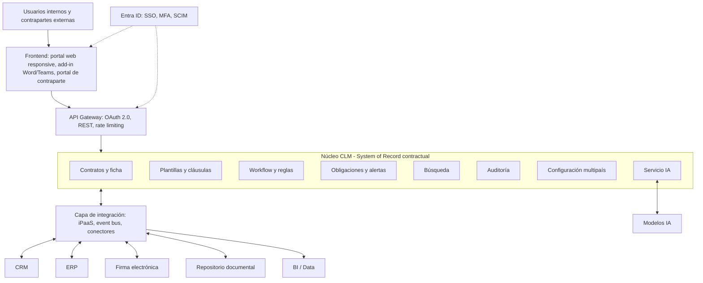
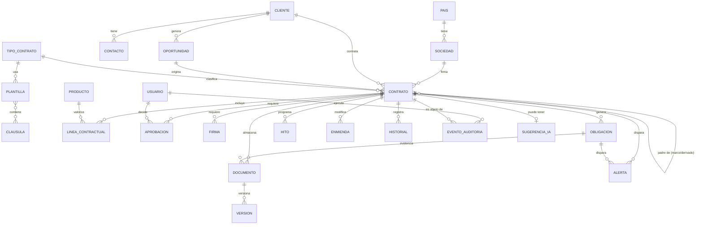
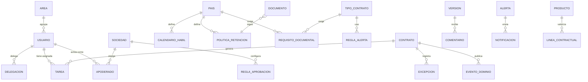
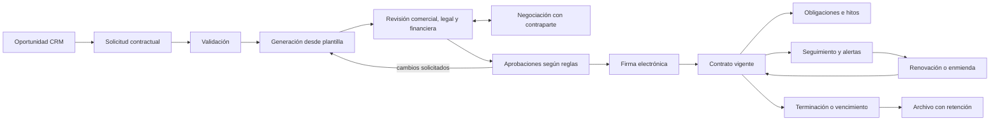
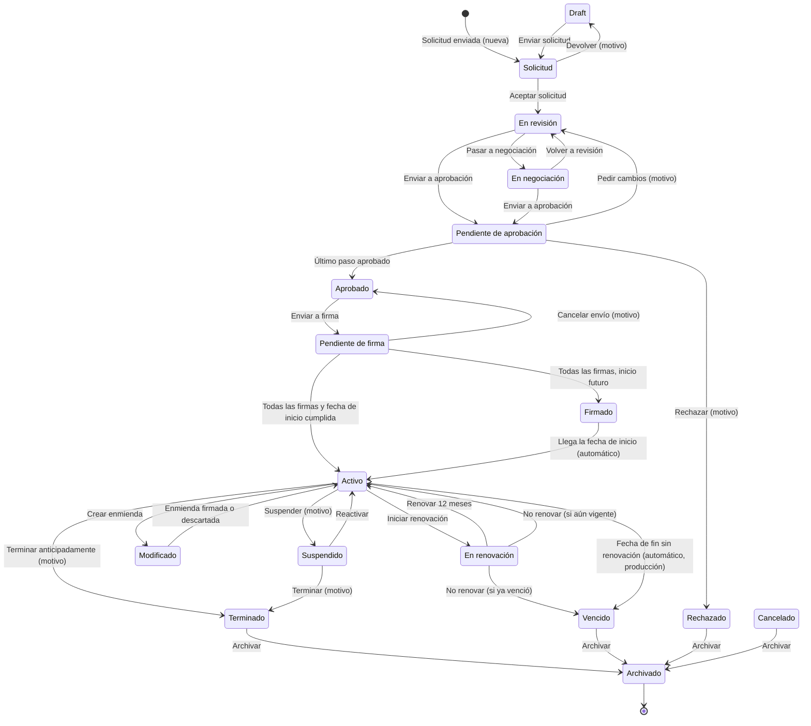
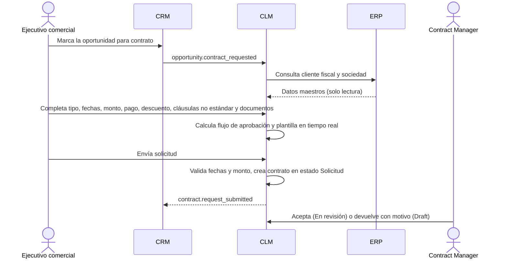
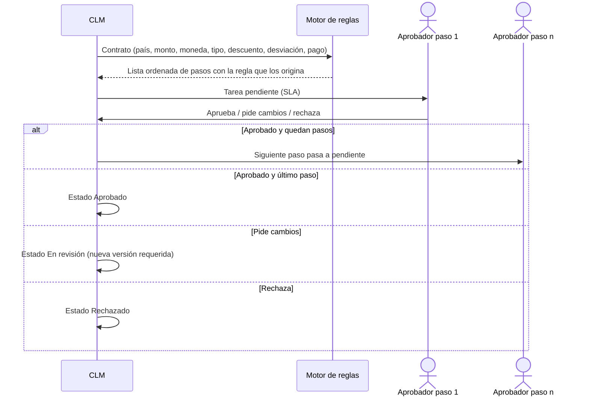
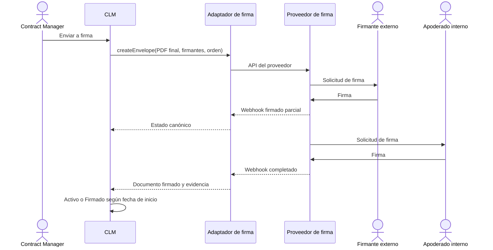
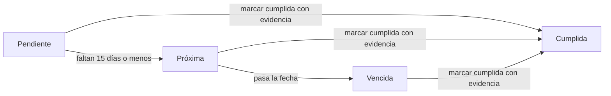
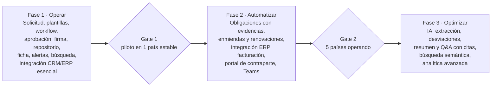

# CLM Área de Desarrollo – Global Vía Pública
## Especificación técnica para proveedor externo: modelo de datos, flujos de proceso y lógica del modelo

| Campo | Valor |
|---|---|
| Documento | Especificación técnica de traspaso (handover) |
| Versión | 1.1 (completa) |
| Fecha | 13 de octubre de 2026 |
| Cliente | Global Vía Pública – Área de Desarrollo (VERTIA GROUP) |
| Alcance geográfico | Argentina, Chile, Perú, México y Uruguay (y futuras operaciones) |
| Audiencia | Empresa externa de desarrollo o integración que construirá o configurará el CLM productivo |
| Estado | Base para cotización, estimación y diseño detallado |

---

## Índice

1. Propósito de este documento
2. Contexto de negocio, visión y alcance
3. Qué existe hoy (inventario de entregables)
4. Actores y roles
5. Arquitectura de solución
6. Principios de datos y matriz CLM vs CRM vs ERP
7. Modelo de datos
8. Flujos de proceso
9. Módulos funcionales
10. Lógica del modelo (reglas de negocio)
11. Gestión documental
12. Firma electrónica
13. Pantallas e interacción
14. Dashboards
15. IA aplicada
16. Integraciones, APIs y eventos
17. Seguridad y permisos
18. Requerimientos no funcionales
19. Modelo multipaís (AR, CL, PE, MX, UY)
20. Gobierno
21. MVP y roadmap
22. KPIs de éxito
23. Riesgos y consideraciones de implementación
24. Brechas entre el prototipo y la solución productiva
25. Decisiones abiertas y supuestos
26. Matriz de trazabilidad de requerimientos
27. Glosario
- Anexo A. Datos de configuración y demostración cargados en el prototipo
- Anexo B. Sistema de diseño (identidad Global Vía Pública)

### Control de versiones

| Versión | Fecha | Cambio |
|---|---|---|
| 1.0 | 13-10-2026 | Primera versión: modelo de datos, flujos y lógica |
| 1.1 | 13-10-2026 | Versión completa: integra las 22 secciones del documento de diseño, entidades de soporte, comportamientos detallados del prototipo, brechas adicionales, matriz de trazabilidad y anexos de datos y diseño |

---

## 1. Propósito de este documento

Este documento permite que una empresa externa entienda, sin depender de reuniones previas, **qué se ha definido y construido hasta ahora** para el CLM (Contract Lifecycle Management) del Área de Desarrollo de Global Vía Pública, y **qué debe construir** para llevarlo a producción.

Cubre tres cosas, que son las que el proveedor necesita para estimar y diseñar:

- **Modelo de datos:** entidades, atributos, tipos, relaciones, catálogos y sistema maestro de cada dato.
- **Flujos de proceso:** ciclo de vida completo, máquina de estados, transiciones permitidas y subprocesos.
- **Lógica del modelo:** reglas de aprobación, cálculos, alertas, tareas, métricas, auditoría y configuración multipaís.

Convenciones:

- Los valores marcados como **(parametrizable)** no deben quedar fijos en código.
- Los valores marcados como **(demo)** existen solo en el prototipo y deben reemplazarse por datos o reglas oficiales de Global.
- Nada en este documento constituye una regla legal o tributaria de un país. Todo requisito que dependa de normativa local se modela como parámetro y lo valida el área Legal o Tributaria de cada país.

---

## 2. Contexto de negocio, visión y alcance

### 2.1 Visión y principios

El CLM será el **orquestador especializado del ciclo contractual** del Área de Desarrollo de Global, operando como un único sistema regional multiempresa para Argentina, Chile, Perú, México y Uruguay, configurado —no reprogramado— por país y sociedad.

Principios rectores:

- **Un dato, un dueño.** El CLM es System of Record del contrato, sus cláusulas, versiones, aprobaciones, firmas y obligaciones. El CRM sigue siendo dueño del cliente comercial, contacto y oportunidad. El ERP sigue siendo dueño del cliente fiscal, sociedad, condiciones de pago, facturación y contabilidad.
- **Configuración sobre código.** País, sociedad, moneda, idioma, zona horaria, plantillas, cláusulas, reglas de aprobación, alertas y requisitos documentales son parámetros, nunca ramas de código por país.
- **Normativa local parametrizada.** El diseño no fija reglas legales o tributarias de ningún país. Cada requisito dependiente de normativa (firma, tributación, retención, protección de datos) se modela como un parámetro que valida el área Legal/Fiscal de cada país.
- **Trazabilidad total.** Cada acción queda registrada: quién, qué, cuándo, por qué y con qué aprobación.
- **IA asistiva.** La IA propone y resume; las personas deciden. Todo contenido generado por IA se marca como tal.
- **Orientado a tareas.** Cada usuario ve qué contratos tiene, en qué estado están, qué debe hacer, qué está atrasado y qué viene después.

### 2.2 Problemas que resuelve

El CLM ataca problemas típicos de la gestión contractual dispersa; su magnitud real debe medirse en el levantamiento inicial (línea base).

| Problema | Impacto en el negocio | Cómo lo resuelve el CLM |
|---|---|---|
| Contratos dispersos en correos, carpetas y discos | Pérdida de versiones, riesgo legal, búsquedas lentas | Repositorio estructurado único con metadata y versión vigente única |
| Datos de cliente y montos reescritos a mano | Errores entre contrato, CRM y factura | Datos heredados de CRM/ERP por integración, no digitados |
| Aprobaciones por correo o WhatsApp | Sin evidencia, sin SLA, cuellos de botella invisibles | Motor de aprobación con reglas, SLA, delegación y auditoría |
| Vencimientos y renovaciones que se pasan | Pérdida de ingresos, renovaciones tácitas no deseadas | Alertas parametrizables por fecha crítica y aviso previo |
| Obligaciones no monitoreadas (garantías, seguros, permisos de emplazamiento, reportes de exhibición) | Multas, incumplimientos, conflicto con clientes y concedentes | Módulo de obligaciones con responsable, evidencia y escalamiento |
| Cláusulas no estándar sin control | Riesgo contractual acumulado | Biblioteca de cláusulas y detección de desviaciones |
| Diferencias por país resueltas con planillas propias | Procesos inconsistentes, imposible consolidar | Modelo multipaís configurable sobre un proceso regional común |
| Falta de visibilidad ejecutiva | Decisiones sin datos de pipeline contractual | Dashboards con drill-down hasta el contrato |
| Facturación desalineada con lo contratado | Fugas de ingreso, notas de crédito | Envío al ERP de condiciones económicas contractualizadas y aprobadas |

### 2.3 Alcance funcional

El alcance cubre todo contrato comercial del Área de Desarrollo, desde la oportunidad hasta el archivo, en las cinco operaciones y futuras.

**Tipos de contrato en alcance (catálogo parametrizable):**

- Venta de espacios OOH (corto, mediano y largo plazo).
- Campañas DOOH (programática, por slots, por circuito o por impactos).
- Indoor (centros comerciales, aeropuertos, transporte).
- Retail Media (acuerdos con retailers, revenue share, data).
- Acuerdos marco con agencias y grandes anunciantes (tarifas, bonificaciones, rappel).
- Concesiones y contratos especiales (municipales, privados, arriendos de ubicaciones).
- Anexos, addendums, prórrogas, renovaciones y terminaciones.
- NDA y cartas de intención asociadas a oportunidades.

**Dentro del alcance:** solicitud, generación, revisión, negociación, aprobación, firma, repositorio, obligaciones, hitos, alertas, modificaciones, renovaciones, terminación, archivo, búsqueda, dashboards, IA asistiva e integraciones con CRM, ERP, firma, identidad y BI.

**Fuera del alcance (permanece en otros sistemas):**

| Proceso | Sistema dueño |
|---|---|
| Gestión de pipeline, forecast y cotización comercial | CRM |
| Maestro fiscal de clientes, facturación electrónica, cobranza, contabilidad, reconocimiento de ingresos | ERP |
| Planificación y ocupación de inventario de soportes, pauta y exhibición | Sistema de inventario/ad-server (se integra como fuente de evidencias) |
| Identidades, grupos y MFA | Entra ID |
| Analítica corporativa consolidada | BI/Data platform |

Pregunta abierta: confirmar si contratos de compras (proveedores, arriendos de ubicaciones) entran en Fase 1 o se incorporan después con el mismo motor.

### 2.4 Modelo de negocio y contexto regional

Global Vía Pública opera en publicidad exterior (OOH), digital (DOOH), Indoor, Retail Media, venta de espacios publicitarios y concesiones, con clientes directos, agencias y grandes anunciantes, en cinco países y varias sociedades.

Principio rector: **el CLM es el orquestador especializado del ciclo contractual**. El CRM y el ERP conservan la propiedad de los datos que naturalmente les corresponden.

---

## 3. Qué existe hoy (inventario de entregables)

| Entregable | Formato | Contenido | Uso para el proveedor |
|---|---|---|---|
| Documento de diseño de solución | Documento (Claude Doc) | Visión, módulos, arquitectura, matriz CLM/CRM/ERP, integraciones, APIs, seguridad, IA, no funcionales, MVP, KPIs, riesgos | Requerimientos funcionales y no funcionales de referencia |
| Prototipo funcional de interfaz | Archivo HTML autocontenido (`clm-global.html`) | Todas las pantallas, flujos, estados, reglas de aprobación, auditoría y configuración, con identidad visual de Global | Especificación visual y de comportamiento; referencia de UX |
| Evaluación económica preliminar (VAE) | Análisis en conversación | Con CLM versus sin CLM, escenarios y supuestos | Contexto de negocio; no se incluye en este documento |
| Este documento | Markdown | Modelo de datos, flujos y lógica | Base de estimación y diseño detallado |

### 3.1 Qué es y qué no es el prototipo

**Es:**

- Una aplicación de una sola página (HTML, CSS y JavaScript sin frameworks) que reproduce el comportamiento esperado del CLM.
- Una especificación ejecutable: cada pantalla, estado, acción y regla descrita aquí se puede ver funcionando.
- Visualmente alineada con la identidad de Global: azul `#0A2240`, rojo `#CE0E2D`, tipografías Montserrat y Poppins, modo claro y oscuro, diseño responsive.

**No es:**

- Un sistema productivo. Toda la lógica corre en el navegador y los datos viven en memoria: al recargar la página se pierden.
- Un sistema seguro. Los permisos y validaciones se ejecutan en el cliente y pueden saltarse.
- Un sistema integrado. CRM, ERP, firma electrónica y Entra ID están **simulados**.

### 3.2 Estado de los datos del prototipo

La base del prototipo está **vacía**: no contiene contratos ni eventos históricos. Conserva solo configuración y datos simulados de otros sistemas:

- Parámetros de los 5 países y sus sociedades.
- Catálogos: tipos de contrato, estados, condiciones de pago, documentación requerida.
- Ventanas de alerta por defecto: 90, 60, 30, 15 y 7 días.
- Nombres de aprobadores por rol y país (simulan Entra ID).
- 5 oportunidades simuladas del CRM, una por país (necesarias para crear solicitudes).

Al abrir la aplicación se registra automáticamente un evento de inicio de sesión en el registro de auditoría.

### 3.3 Stack del prototipo

| Capa | Implementación en el prototipo |
|---|---|
| Interfaz | HTML5 y CSS con variables (tokens de diseño), sin frameworks |
| Lógica | JavaScript (ES2020) en el navegador; renderizado por plantillas de texto |
| Estado | Objetos en memoria (`contracts`, `AUDIT`, `ui`) |
| Tipografías | Google Fonts: Montserrat, Poppins |
| Persistencia | Ninguna (solo la preferencia de tema en `localStorage`) |

El código de interfaz puede portarse a un framework productivo (por ejemplo React). **La lógica de negocio debe reescribirse en el servidor.**

---

## 4. Actores y roles

Cada rol se asigna con alcance (país, sociedad, área, tipo de contrato, nivel de confidencialidad); un mismo usuario puede tener roles distintos en países distintos.

| Rol | Responsabilidad principal | Acciones clave en el CLM |
|---|---|---|
| Ejecutivo comercial (solicitante) | Origina la necesidad desde la oportunidad | Crea solicitud, adjunta antecedentes, negocia con cliente |
| Jefe/Gerente comercial | Valida condiciones comerciales y descuentos | Revisa, aprueba dentro de atribuciones |
| Contract Manager (Desarrollo) | Owner operativo del contrato durante todo el ciclo | Genera borrador, coordina revisiones, administra obligaciones, renovaciones |
| Abogado / Legal país | Revisión jurídica y cláusulas no estándar | Redlining, aprueba desviaciones, valida plantillas locales |
| Finanzas / Control de gestión | Condiciones económicas, pago, riesgo crédito | Revisa y aprueba montos, plazos de pago, garantías |
| Tributario / Fiscal país | Requisitos fiscales locales | Valida parámetros tributarios y datos fiscales |
| Operaciones / Exhibición | Factibilidad técnica y operativa (soportes, pantallas, instalación) | Revisa, carga evidencias de cumplimiento |
| Compras | Contratos con proveedores/concedentes cuando aplique | Revisa y aprueba |
| Tecnología | Contratos con componentes técnicos (DOOH, data, integraciones) | Revisa anexos técnicos |
| Compliance | Contrapartes, conflictos de interés, políticas | Revisa due diligence, aprueba excepciones |
| Gerencia País / Regional | Aprobaciones por umbral o riesgo | Aprueba, aprueba excepciones extraordinarias |
| Apoderado firmante | Representación legal de la sociedad | Firma interna |
| Firmante externo (cliente, agencia, concedente) | Representación de la contraparte | Firma vía proveedor de firma, sin licencia CLM |
| Administrador funcional | Configuración del sistema | Plantillas, cláusulas, reglas, catálogos, alertas |
| Administrador técnico | Plataforma e integraciones | Monitoreo, conectores, seguridad |
| Auditor (interno/externo) | Control | Solo lectura sobre contratos y logs de auditoría |
| Consultor / Lector | Consulta de información | Visualiza según permisos |

---

## 5. Arquitectura de solución

La solución productiva se organiza en capas. Ningún servicio del núcleo CLM llama directamente a CRM, ERP o firma: todo pasa por una capa de integración, lo que permite cambiar de proveedor sin tocar el núcleo.



La arquitectura es modular por capas: ningún servicio del núcleo CLM llama directamente a CRM, ERP o firma; todo pasa por la capa de integración, lo que permite cambiar de proveedor sin tocar el núcleo.

Entra ID provee identidad a todas las capas (SSO en frontend, tokens en gateway, grupos para RBAC). BI consume una réplica analítica, nunca la base transaccional.

**Decisión build vs. buy:** el diseño es válido tanto para una plataforma CLM SaaS de mercado (configurada) como para un desarrollo propio o híbrido. Se recomienda evaluar primero plataformas CLM SaaS que cumplan esta arquitectura y construir solo lo diferencial (reglas de negocio OOH/DOOH, integraciones).

| Componente | Función | Responsabilidad | Datos | Integraciones | Tecnología sugerida (agnóstica) | Dependencias |
|---|---|---|---|---|---|---|
| Portal web | Interfaz principal orientada a tareas | Bandeja de tareas, ficha, dashboards, búsqueda | Ninguno persistente | API Gateway, Entra ID | SPA (React/Angular) o UI de la plataforma CLM | Gateway, SSO |
| Add-in Word / Teams | Edición y aprobación donde trabaja el usuario | Redlining, aprobaciones rápidas, notificaciones | Ninguno persistente | API CLM, Microsoft Graph | Office Add-in, Teams app | M365 |
| Portal de contraparte | Colaboración externa controlada | Carga de documentos, negociación, evidencias | Documentos entrantes | API CLM | Portal con acceso por link seguro + OTP | Seguridad externa |
| API Gateway | Punto único de entrada | AuthN/AuthZ de tokens, throttling, versionado | Logs de acceso | Todos los consumidores | Azure API Management, Kong, Apigee o equivalente | Entra ID |
| Contratos y ficha | Núcleo del dominio | Ciclo de vida, estados, versiones, enmiendas | Contrato, versión, anexo, enmienda | Todos los servicios internos | Microservicio o módulo de plataforma; BD relacional | BD, DMS |
| Plantillas y cláusulas | Generación documental | Biblioteca, variables, ensamblado, desviaciones | Plantilla, cláusula, variante | Contratos, IA | Motor de documentos (DOCX/PDF) | Config multipaís |
| Workflow y reglas | Orquestación | Flujos, aprobaciones, SLA, delegación, escalamiento | Instancias de flujo, tareas, reglas | Entra ID, notificaciones | Motor BPMN/DMN (Camunda, Flowable, Temporal) o nativo | Contratos |
| Obligaciones y alertas | Post-firma | Obligaciones, hitos, calendario de alertas | Obligación, hito, alerta | Correo, Teams, inventario | Scheduler + cola | Workflow |
| Búsqueda | Recuperación | Full-text, filtros, semántica, security trimming | Índice (derivado) | DMS, Contratos | Elasticsearch/OpenSearch/Azure AI Search | Permisos |
| Auditoría | Trazabilidad | Registro inmutable de eventos | Evento de auditoría | SIEM | Log append-only (WORM) | Todos |
| Config multipaís | Parametrización | Países, sociedades, catálogos, reglas locales | Parámetros | ERP (sociedades) | Módulo de configuración con versionado | — |
| Servicio IA | Asistencia | Extracción, resumen, comparación, Q&A | Sugerencias IA (separadas) | Modelos IA, Búsqueda | Orquestador LLM con RAG y registro de prompts | Búsqueda, DMS |
| Capa de integración | Desacople | Transformación, ruteo, reintentos, DLQ | Mensajes en tránsito (temporales) | CRM, ERP, firma, BI | iPaaS (Azure Integration Services, MuleSoft, Boomi) + event bus (Service Bus, Kafka) | Conectores |
| DMS / Storage | Repositorio binario | Almacenamiento cifrado, retención, WORM | Archivos | Contratos | SharePoint/Blob/S3 con políticas de retención | Cifrado, KMS |
| BI / Data | Analítica | Dashboards corporativos, consolidación regional | Réplica analítica | CLM, CRM, ERP | Power BI + data warehouse/lakehouse | Integración |

---

## 6. Principios de datos y matriz CLM vs CRM vs ERP

Regla de oro: **cada dato tiene un solo sistema que lo crea y modifica**; los demás lo consultan o mantienen una réplica de solo lectura, actualizada por evento.

Leyenda: **M** = maestro (crea/modifica) · **R** = réplica solo lectura · **L** = referencia/link · **D** = derivado · **T** = temporal · — = no aplica.

| Dato / Proceso | CLM | CRM | ERP | Sistema maestro | Tipo en CLM | Dirección | Frecuencia / disparador |
|---|---|---|---|---|---|---|---|
| Cliente comercial (nombre, segmento, ejecutivo) | R | M | R | CRM | Réplica | CRM → CLM | Evento `account.updated` + consulta en línea al crear solicitud |
| Cliente fiscal (razón social, ID tributario, dirección fiscal) | R | R | M | ERP | Réplica | ERP → CLM, ERP → CRM | Evento `customer.updated`; alta de cliente nuevo se solicita al ERP, no se crea en CLM |
| Contacto / firmante de contraparte | R | M | — | CRM | Réplica | CRM → CLM | Evento + consulta en línea |
| Oportunidad | L | M | — | CRM | Referencia | CRM → CLM | Evento `opportunity.contract_requested` |
| Productos / tarifas de lista | R | M o R | M o R | ERP o CRM (a definir) | Réplica | Maestro → CLM | Diario + evento de cambio |
| Sociedad / entidad legal | R | R | M | ERP | Réplica | ERP → CLM | Diario + evento |
| Centro de costo | R | — | M | ERP | Réplica | ERP → CLM | Diario |
| Moneda y tipos de cambio | R | R | M | ERP | Réplica | ERP → CLM | Diario (tipo de cambio para reporting) |
| Condiciones de pago (catálogo) | R | — | M | ERP | Réplica | ERP → CLM | Diario |
| Condiciones de pago acordadas en el contrato | M | R | R | CLM | Maestro | CLM → ERP, CLM → CRM | Evento `contract.activated` |
| Límite / riesgo de crédito | R | — | M | ERP | Consulta | ERP → CLM | En línea durante revisión financiera |
| Contrato (texto, cláusulas, versiones) | M | L | L | CLM | Maestro | CLM → CRM/ERP (link) | Evento por cambio de estado |
| Estado contractual | M | R | R | CLM | Maestro | CLM → CRM, CLM → ERP | Evento `contract.status_changed` (casi tiempo real) |
| Monto contractual y líneas negociadas | M | R | R | CLM | Maestro | CLM → CRM (cierre), CLM → ERP (facturación) | Evento `contract.activated` / `amendment.activated` |
| Vigencia, renovación, fechas críticas | M | R | R | CLM | Maestro | CLM → CRM, ERP | Evento |
| Aprobaciones y firmas | M | R (resumen) | — | CLM | Maestro | CLM → CRM | Evento `contract.signed` |
| Obligaciones e hitos | M | — | R (hitos de facturación) | CLM | Maestro | CLM → ERP | Evento `milestone.due` |
| Plan de facturación / órdenes de venta | L | — | M | ERP | Referencia | CLM → ERP (insumo), ERP → CLM (ID) | Evento + respuesta con `erp_order_id` |
| Facturas, cobros, saldo | D | — | M | ERP | Derivado (indicador facturado vs. contratado) | ERP → CLM | Diario |
| Reconocimiento de ingresos, contabilidad | — | — | M | ERP | — | — | No se replica |
| Forecast y pipeline comercial | — | M | — | CRM | — | — | No se replica |
| Usuarios, jerarquía, grupos | R | R | R | Entra ID | Réplica | Entra ID → todos | SCIM / tiempo real |
| Borrador de solicitud en edición | T | — | — | CLM | Temporal | — | Se descarta o se consolida al enviar |
| Índice de búsqueda, KPIs, desviación | D | — | — | CLM | Derivado | CLM → BI | Continuo / diario |
| Sugerencias de IA | T/D | — | — | CLM (separado) | Derivado no oficial | — | Nunca sobrescribe datos oficiales sin confirmación humana |

Controles que evitan la doble edición:

- Los campos réplica se muestran bloqueados en la UI del CLM con enlace "editar en CRM/ERP".
- Las APIs del CLM rechazan escrituras sobre campos réplica (respuesta 409 con el sistema maestro indicado).
- En CRM y ERP, los campos que llegan del CLM se configuran como solo lectura.
- Pregunta abierta: definir si el catálogo de productos/tarifas es maestro en ERP o en CRM; el CLM se adapta a cualquiera de los dos.

---

## 7. Modelo de datos

### 7.1 Diagrama entidad-relación

El **Contrato** es la entidad raíz. Todo lo demás cuelga de él o es una referencia a un maestro externo, identificada por su ID de origen (`crm_id`, `erp_id`, `entra_id`) y nunca copiada como dato editable.



### 7.2 Convenciones comunes a todas las entidades

| Campo | Tipo | Descripción |
|---|---|---|
| `id` | UUID | Identificador técnico interno |
| `pais` | char(2) | Código ISO del país (AR, CL, PE, MX, UY); obligatorio para seguridad por fila |
| `sociedad_id` | UUID | Sociedad dueña del registro; obligatorio para seguridad por fila |
| `created_at`, `created_by` | timestamp UTC, UUID | Creación |
| `updated_at`, `updated_by` | timestamp UTC, UUID | Última modificación |
| `row_version` | integer | Control de concurrencia optimista |

Todas las fechas y horas se guardan en **UTC**. La interfaz las presenta en la zona horaria de la sociedad.

### 7.3 Diccionario de datos

La columna **Prototipo** indica si el campo ya existe en `clm-global.html` (✓) o es requerido solo para producción (P).

#### País (configuración)

| Campo | Tipo | Oblig. | Prototipo | Descripción |
|---|---|---|---|---|
| `codigo` | char(2) | Sí | ✓ | AR, CL, PE, MX, UY |
| `nombre` | text | Sí | ✓ | Argentina, Chile, Perú, México, Uruguay |
| `moneda_local` | char(3) | Sí | ✓ | ARS, CLP, PEN, MXN, UYU |
| `monedas_unidades_adicionales` | text[] | No | ✓ | Ej.: USD, UF, UDI, UI, índices de ajuste (parametrizable) |
| `idioma` | text | Sí | ✓ | es-AR, es-CL, es-PE, es-MX, es-UY |
| `zona_horaria` | text | Sí | ✓ (texto) | En producción, identificador IANA por sociedad |
| `identificador_fiscal` | text | Sí | ✓ | CUIT, RUT, RUC, RFC (nombre del identificador) |
| `marco_firma_referencia` | text | No | ✓ | Marco legal a validar por Legal local |
| `calendario_habil_id` | UUID | Sí | P | Feriados y días hábiles para el cálculo de SLA |
| `politica_retencion_id` | UUID | Sí | P | Plazos de retención documental por tipo |

#### Sociedad (réplica ERP)

| Campo | Tipo | Oblig. | Prototipo | Descripción |
|---|---|---|---|---|
| `erp_id` | text | Sí | P | ID en el ERP |
| `razon_social` | text | Sí | ✓ | Ej. (demo): GVP Chile SpA |
| `pais` | char(2) | Sí | ✓ | |
| `identificador_fiscal_valor` | text | Sí | P | Número tributario |
| `codigo_sociedad` | char(2) | Sí | P | Usado en el ID contractual (en el prototipo fijo "01") |
| `monedas_permitidas` | char(3)[] | Sí | P | |
| `condicion_pago_estandar` | text | Sí | P | Base para la regla de plazo de pago |

#### Cliente (CRM comercial + ERP fiscal)

| Campo | Tipo | Oblig. | Prototipo | Origen | Descripción |
|---|---|---|---|---|---|
| `crm_id` | text | Sí | P | CRM | |
| `erp_id` | text | Sí para activar | P | ERP | Requerido antes de enviar al ERP |
| `nombre_comercial` | text | Sí | ✓ (`cliente`) | CRM | |
| `razon_social` | text | Sí | P | ERP | |
| `tipo` | enum | Sí | P | CRM | Directo, Agencia, Anunciante |
| `segmento` | text | No | P | CRM | |

#### Contacto (réplica CRM)

| Campo | Tipo | Oblig. | Prototipo | Descripción |
|---|---|---|---|---|
| `crm_id` | text | Sí | P | |
| `nombre` | text | Sí | ✓ (`contacto`) | |
| `correo` | text | Sí | P | Necesario para la firma electrónica |
| `rol_contractual` | enum | No | P | Firmante, Notificaciones, Operativo |

#### Oportunidad (referencia CRM)

| Campo | Tipo | Oblig. | Prototipo | Descripción |
|---|---|---|---|---|
| `id` | text | Sí | ✓ | Ej. (demo): OPP-CRM-004512 |
| `cliente` | ref | Sí | ✓ | |
| `contacto` | ref | Sí | ✓ | |
| `ejecutivo` | ref Usuario | Sí | ✓ | |
| `pais` | char(2) | Sí | ✓ | |
| `monto` | decimal(18,2) | Sí | ✓ | Monto estimado |
| `moneda` | char(3) | Sí | ✓ | |
| `producto` | text | Sí | ✓ | |
| `cierre` | date | No | ✓ | Fecha estimada de cierre |

#### Usuario (réplica Entra ID)

| Campo | Tipo | Oblig. | Prototipo | Descripción |
|---|---|---|---|---|
| `entra_id` | UUID | Sí | P | |
| `nombre` | text | Sí | ✓ | |
| `cargo`, `area`, `pais` | text | Sí | P | |
| `jefe_directo_id` | UUID | No | P | Base para escalamientos |
| `roles` | rol[] con alcance | Sí | P | Ver sección 17 |

#### Tipo de contrato (catálogo)

| Campo | Tipo | Oblig. | Prototipo | Descripción |
|---|---|---|---|---|
| `codigo` | text | Sí | ✓ | OOH, DOOH, Indoor, Retail Media, Acuerdo marco agencia, Concesión |
| `plantilla_por_pais` | map | Sí | ✓ (nombre) | Plantilla aplicable por país e idioma |
| `documentos_requeridos` | text[] | Sí | ✓ | Ver 10.3 |
| `obligaciones_tipicas` | json | No | P | Obligaciones sugeridas al activar |
| `alertas_por_defecto` | int[] | No | P | Sobrescribe las ventanas globales |

#### Contrato (entidad raíz, maestro CLM)

| Campo | Tipo | Oblig. | Prototipo | Descripción |
|---|---|---|---|---|
| `id_contractual` | text único | Sí | ✓ (`id`) | Formato en 7.5 |
| `cliente_id` | ref | Sí | ✓ (`cliente`) | |
| `contraparte_id` | ref | Sí | ✓ (`contraparte`) | Si no se indica, es igual al cliente (ej. agencia distinta del anunciante) |
| `contacto_firmante_id` | ref | Sí | ✓ (`contacto`) | |
| `oportunidad_id` | ref | Sí | ✓ (`opp`) | |
| `tipo` | ref Tipo | Sí | ✓ | |
| `pais` | char(2) | Sí | ✓ | |
| `sociedad_id` | ref | Sí | ✓ (`sociedad`) | Derivada del país en el prototipo; seleccionable en producción |
| `estado` | enum | Sí | ✓ | Catálogo en 7.4 |
| `fecha_inicio` | date | Sí | ✓ (`inicio`) | |
| `fecha_fin` | date | Sí | ✓ (`fin`) | Debe ser posterior a `fecha_inicio` |
| `monto` | decimal(18,2) | Sí | ✓ | Mayor que cero |
| `moneda` | char(3) | Sí | ✓ | Moneda local de la sociedad o USD |
| `unidad_reajuste` | text | No | P | UF, UDI, UI, índice (parametrizable) |
| `formula_reajuste` | json | No | P | |
| `condicion_pago` | text | Sí | ✓ (`pago`) | 30, 45, 60 o 90 días (catálogo ERP) |
| `descuento_pct` | decimal(5,2) | Sí | ✓ (`descuento`) | Descuento sobre lista |
| `condiciones_especiales` | text | No | ✓ (en historial) | Bonificaciones, exclusividades, hitos |
| `renovacion_automatica` | boolean | Sí | ✓ (`renovAuto`) | |
| `indice_desviacion` | integer 0–100 | Sí | ✓ (`desviacion`) | % de cláusulas modificadas o no estándar |
| `confidencial` | boolean | Sí | ✓ | Restringe la visibilidad a una lista nominativa |
| `ejecutivo_id` | ref Usuario | Sí | ✓ (`ejecutivo`) | Responsable comercial |
| `contract_manager_id` | ref Usuario | Sí | ✓ (`cm`) | Responsable contractual |
| `contrato_padre_id` | ref Contrato | No | P | Acuerdo marco → contratos derivados |
| `fecha_creacion` | date | Sí | ✓ (`creado`) | |
| `erp_order_id` | text | No | P | Respuesta del ERP al activar |
| `ciclo_dias` | integer | Derivado | ✓ (`ciclo`) | Días de solicitud a firma |
| `dias_por_etapa` | json | Derivado | ✓ (`etapas`) | Base del análisis de cuellos de botella |

#### Línea contractual / condición comercial

| Campo | Tipo | Oblig. | Prototipo | Descripción |
|---|---|---|---|---|
| `producto` | text o ref Producto | Sí | ✓ (`p`) | Ej.: "DOOH circuito metro, 24 pantallas" |
| `cantidad` | decimal | Sí | ✓ (`q`) | |
| `unidad` | text | Sí | ✓ (`u`) | mes, campaña, contrato, año, cara, slot, impacto |
| `precio_unitario` | decimal(18,2) | Sí | ✓ (`pu`) | |
| `subtotal` | decimal(18,2) | Derivado | ✓ | `cantidad × precio_unitario` |

Regla: `monto` del contrato = Σ subtotales. En el prototipo, una solicitud nueva genera una sola línea con el producto de la oportunidad, cantidad 1 y precio igual al monto.

#### Versión de documento

| Campo | Tipo | Oblig. | Prototipo | Descripción |
|---|---|---|---|---|
| `numero` | integer | Sí | ✓ (`n`) | Correlativo por contrato, desde 1 |
| `autor` | ref Usuario o contraparte | Sí | ✓ | |
| `fecha` | timestamp | Sí | ✓ | |
| `motivo` | text | Sí | ✓ | Ej.: "Generado desde plantilla", "Versión de contraparte" |
| `cambios` | json [{tipo: add/del, texto}] | Sí | ✓ | Base de la comparación de versiones |
| `archivo_uri` | text | Sí | P | Ubicación en el repositorio |
| `hash_sha256` | char(64) | Sí | P | Integridad del archivo |
| `vigente` | boolean | Derivado | ✓ | Solo la última versión es vigente |

#### Aprobación (paso de flujo)

| Campo | Tipo | Oblig. | Prototipo | Descripción |
|---|---|---|---|---|
| `orden` | integer | Sí | ✓ (posición) | |
| `rol` | text | Sí | ✓ | Ver 10.1 |
| `aprobador_id` | ref Usuario | Sí | ✓ (`nombre`) | Resuelto por rol y país |
| `delegado_de_id` | ref Usuario | No | P | Si aprueba un delegado |
| `estado` | enum | Sí | ✓ | `en espera`, `pendiente`, `aprobado`, `cambios`, `rechazado` |
| `fecha_decision` | timestamp | No | ✓ (`fecha`) | |
| `dias` | integer | Derivado | ✓ | Días hábiles que tomó la decisión |
| `comentario` | text | Cond. | ✓ | Obligatorio al pedir cambios o rechazar |
| `regla_aplicada` | text | Sí | ✓ (en la vista de solicitud) | Motivo por el que el paso existe |
| `modo` | enum | Sí | P | Secuencial, paralelo, quórum |
| `sla_dias` | integer | Sí | P | |

#### Firma

| Campo | Tipo | Oblig. | Prototipo | Descripción |
|---|---|---|---|---|
| `orden` | integer | Sí | ✓ (posición) | Secuencial en el prototipo |
| `firmante` | text o ref | Sí | ✓ (`nombre`) | |
| `parte` | enum | Sí | ✓ | Externa, Interna |
| `estado` | enum | Sí | ✓ | `en espera`, `enviado`, `firmado` (producción agrega visto, rechazado, expirado, cancelado) |
| `fecha_firma` | timestamp | No | ✓ (`fecha`) | |
| `proveedor`, `envelope_id` | text | Sí | P | Identificadores del proveedor de firma |
| `metodo_autenticacion` | text | Sí | P | Correo, OTP, identidad nacional, certificado |
| `evidencia_uri` | text | Sí | P | Certificado de auditoría del proveedor |

#### Obligación

| Campo | Tipo | Oblig. | Prototipo | Descripción |
|---|---|---|---|---|
| `id` | text | Sí | ✓ | |
| `descripcion` | text | Sí | ✓ (`desc`) | |
| `responsable_id` | ref Usuario | Sí | ✓ (`resp`) | Responsable interno |
| `responsable_contraparte` | text | No | ✓ (`cp`) | |
| `fecha_cumplimiento` | date | Sí | ✓ (`fecha`) | |
| `periodicidad` | enum | Sí | ✓ (`per`) | Única, Mensual, Trimestral, Semestral, Anual, Por campaña |
| `evidencia_requerida` | text | Sí | ✓ (`evid`) | |
| `riesgo` | enum | Sí | ✓ | Bajo, Medio, Alto |
| `cumplida` | boolean | Sí | ✓ (`done`) | |
| `evidencia_cargada` | text o ref Documento | Cond. | ✓ (`evidencia`) | Obligatoria para marcar cumplida |
| `estado` | enum | Derivado | ✓ | Ver 10.4 |
| `sla_dias`, `escalamiento_a` | integer, ref | No | P | |

#### Enmienda (incluye renovaciones)

| Campo | Tipo | Oblig. | Prototipo | Descripción |
|---|---|---|---|---|
| `id` | text | Sí | ✓ | `{id_contractual}-A{nn}` (enmienda) o `-R{nn}` (renovación) |
| `tipo` | enum | Sí | ✓ | Anexo, Addendum, Prórroga, Cambio de precio, Cambio de condiciones comerciales, Cambio de contraparte, Renovación |
| `fecha_efectiva` | date | Sí | ✓ (`fecha`) | |
| `descripcion` | text | Sí | ✓ (`desc`) | |
| `estado` | enum | Sí | ✓ | En revisión, Activa, Descartada |
| `cambios_estructurados` | json (antes/después) | Sí | P | Campos del contrato que modifica |

#### Alerta

| Campo | Tipo | Oblig. | Prototipo | Descripción |
|---|---|---|---|---|
| `origen` | ref Contrato/Obligación/Hito | Sí | ✓ (contrato) | |
| `dias_anticipacion` | integer | Sí | ✓ | Ventanas configurables |
| `fecha_disparo` | date | Derivado | ✓ | `fecha_fin − días` |
| `estado` | enum | Derivado | ✓ | Programada, Enviada |
| `destinatarios`, `canal`, `escalamiento` | — | Sí | P | Rol, correo/Teams/in-app |

#### Historial del contrato

| Campo | Tipo | Prototipo | Descripción |
|---|---|---|---|
| `fecha` | date | ✓ | |
| `actor` | ref Usuario | ✓ | |
| `accion` | text | ✓ | Ej.: "Enviado a aprobación" |
| `detalle` | text | ✓ | Motivo, regla o referencia |

#### Evento de auditoría (registro global, inmutable)

| Campo | Tipo | Prototipo | Descripción |
|---|---|---|---|
| `seq` | bigint | ✓ | Correlativo global |
| `ts` | timestamp | ✓ | Fecha y hora del evento |
| `actor` | ref Usuario | ✓ | |
| `rol` | text | ✓ | Rol del actor al momento del evento |
| `cat` | enum | ✓ | Ver 10.10 |
| `accion` | text | ✓ | |
| `objeto` | text | ✓ | ID contractual u objeto de sistema |
| `pais` | char(2) | ✓ | Nulo para eventos regionales (ej. inicio de sesión) |
| `detalle` | text | ✓ | |
| `antes`, `despues` | text | ✓ | Valores anterior y nuevo |
| `resultado` | enum | ✓ | Correcto, Denegado |
| `ip` | text | ✓ (simulada) | |
| `prev`, `hash` | text | ✓ | Encadenamiento (ver 10.10) |

#### Sugerencia IA (capa separada)

| Campo | Tipo | Prototipo | Descripción |
|---|---|---|---|
| `texto` | text | ✓ (`ai`) | Resumen ejecutivo sugerido |
| `estado` | enum | ✓ (`aiEstado`) | sugerido, aceptado, descartado |
| `modelo`, `version`, `prompt`, `fuentes` | — | P | Trazabilidad obligatoria en producción |
| `aceptado_por`, `fecha` | — | P | Al aceptar pasa a dato oficial |

#### Campos adicionales del Contrato requeridos en producción

| Campo | Tipo | Oblig. | Descripción |
|---|---|---|---|
| `solicitante_id` | ref Usuario | Sí | Quien originó la solicitud (base de la segregación de funciones) |
| `area_id` | ref Área | Sí | Área solicitante |
| `plantilla_id` | ref Plantilla | Sí | Plantilla y versión aplicadas |
| `centro_costo_id` | ref (ERP) | No | Centro de costo asociado |
| `contrato_marco_id` | ref Contrato | No | Acuerdo marco del que deriva (agencias, contratos multipaís) |
| `es_excepcion` | boolean | Sí | Marca permanente si tuvo aprobación extraordinaria |
| `justificacion_excepcion` | text | Cond. | Obligatoria si `es_excepcion` |
| `fecha_firma` | timestamp | Derivado | Fecha de la última firma |
| `fecha_activacion` | timestamp | Derivado | Inicio efectivo de vigencia |
| `motivo_cierre` | text | Cond. | Obligatorio al rechazar, cancelar, suspender o terminar |
| `aviso_previo_dias` | integer | No | Días de aviso de no renovación pactados |
| `sub_estado` | text | No | Sub-estado local mapeado a un estado global (ver 10.12) |

#### Campos adicionales de la Línea contractual requeridos en producción

| Campo | Tipo | Descripción |
|---|---|---|
| `descuento_pct` | decimal | Descuento de la línea |
| `bonificacion` | text o decimal | Bonificaciones pactadas (slots, caras, campañas) |
| `periodo` | enum | Mensual, por campaña, anual, único |
| `forma_pago` | text | Si difiere de la condición general del contrato |
| `fecha_desde`, `fecha_hasta` | date | Vigencia de la línea |

### 7.4 Catálogos

**Estados del contrato (17):** Draft, Solicitud, En revisión, En negociación, Pendiente de aprobación, Aprobado, Pendiente de firma, Firmado, Activo, En renovación, Modificado, Suspendido, Terminado, Vencido, Archivado, Rechazado, Cancelado.

**Etapas visibles (barra de avance de la ficha):**

| Etapa | Estados que la componen |
|---|---|
| Solicitud | Draft, Solicitud |
| Revisión | En revisión, En negociación |
| Aprobación | Pendiente de aprobación, Aprobado |
| Firma | Pendiente de firma, Firmado |
| Vigente | Activo, En renovación, Modificado, Suspendido |
| Cierre | Terminado, Vencido, Archivado, Rechazado, Cancelado |

**Tipos de contrato:** OOH, DOOH, Indoor, Retail Media, Acuerdo marco agencia, Concesión.

**Condiciones de pago (catálogo ERP):** 30, 45, 60 y 90 días.

**Tipos de enmienda:** Anexo, Addendum, Prórroga, Cambio de precio, Cambio de condiciones comerciales, Cambio de contraparte (más Renovación, generada por el flujo de renovación).

**Estados de obligación:** Pendiente, Próxima, Vencida, Cumplida.

**Categorías de auditoría:** Acceso, Solicitud, Estado, Documento, Aprobación, Firma, Obligación, Modificación, IA, Configuración.

### 7.5 Identificador contractual

Formato: `GVP-{PAÍS}-{SOCIEDAD}-{AÑO}-{CORRELATIVO}`. Ejemplo: `GVP-CL-01-2026-000001`.

- `PAÍS`: código ISO de 2 letras.
- `SOCIEDAD`: código de 2 dígitos de la sociedad (en el prototipo fijo "01").
- `AÑO`: año de creación (en el prototipo fijo "2026"; en producción, el año real).
- `CORRELATIVO`: 6 dígitos con ceros a la izquierda, por país y sociedad.
- Enmiendas: sufijo `-A01`, `-A02`… Renovaciones: sufijo `-R01`, `-R02`…

El prototipo calcula el correlativo como "cantidad de contratos del país + 1". **En producción debe usarse una secuencia transaccional** por país, sociedad y año, sin reutilizar números.

### 7.6 Entidades de soporte requeridas en producción

Estas entidades no existen en el prototipo, pero el diseño las necesita para cubrir revisión, gobierno, multipaís y gestión documental.

#### Área

| Campo | Tipo | Descripción |
|---|---|---|
| `codigo`, `nombre` | text | |
| `sociedad_id` | ref | Origen ERP/RR.HH. o CLM |

#### Producto o servicio (réplica del maestro ERP o CRM)

| Campo | Tipo | Descripción |
|---|---|---|
| `codigo` | text | Código del sistema maestro |
| `familia` | enum | OOH, DOOH, Indoor, Retail Media, Concesión |
| `unidad` | enum | Cara, slot, impacto, circuito, mes, campaña |
| `precio_lista` | decimal | Base para calcular el % de descuento |

#### Plantilla

| Campo | Tipo | Descripción |
|---|---|---|
| `tipo_contrato`, `pais`, `idioma` | ref, char(2), text | Combinación única por versión |
| `version` | text | Ej.: v2026.1 |
| `vigente_desde`, `vigente_hasta` | date | |
| `estado` | enum | Borrador, Aprobada, Retirada |
| `dueno` | ref Usuario | Legal país o regional |
| `variables` | json | Ej.: `{{cliente.razon_social}}`, `{{monto}}`, `{{moneda}}` |

#### Cláusula (biblioteca)

| Campo | Tipo | Descripción |
|---|---|---|
| `codigo` | text | |
| `titulo` | text | |
| `texto` | text por idioma y país | |
| `clasificacion` | enum | Obligatoria, Opcional, Alternativa pre-aprobada, No estándar |
| `riesgo` | enum | Bajo, Medio, Alto |
| `requiere_aprobacion_de` | rol | Ej.: Legal país si se modifica |
| `version`, `estado` | text, enum | |

Relación de instancia: cada Versión de documento guarda qué cláusulas contiene, en qué variante y si fueron modificadas (base del índice de desviación).

#### Documento

| Campo | Tipo | Descripción |
|---|---|---|
| `tipo` | enum | Borrador, Versión aprobada, Contrato firmado, Evidencia de firma, Anexo, Documento de contraparte, Evidencia de cumplimiento |
| `clasificacion` | enum | Público interno, Confidencial, Restringido |
| `archivo_uri`, `hash_sha256`, `tamano`, `mime` | — | |
| `fecha_vencimiento` | date | Para poderes, garantías, seguros, certificaciones |
| `politica_retencion_id` | ref | |
| `legal_hold` | boolean | Suspende la eliminación |
| `origen` | enum | Generado, Subido, Proveedor de firma, Migrado |

#### Hito

| Campo | Tipo | Descripción |
|---|---|---|
| `nombre` | text | |
| `tipo` | enum | Inicio, Entrega, Facturación, Revisión de precio, Reajuste |
| `fecha` | date | |
| `estado` | enum | Pendiente, Cumplido |
| `notifica_erp` | boolean | Si genera `milestone.due` hacia el ERP |

#### Comentario de revisión

| Campo | Tipo | Descripción |
|---|---|---|
| `version_id`, `clausula_ref` | ref | Anclaje del comentario |
| `autor`, `menciones` | ref Usuario | |
| `texto` | text | |
| `estado` | enum | Abierto, Resuelto |

#### Tarea

| Campo | Tipo | Descripción |
|---|---|---|
| `tipo` | enum | Validar solicitud, Revisar, Aprobar, Enviar a firma, Decidir renovación, Cumplir obligación, Manual |
| `asignado_a` | ref Usuario o rol | |
| `objeto` | ref Contrato/Obligación | |
| `vencimiento` | timestamp | Calculado con el SLA y el calendario hábil |
| `estado` | enum | Pendiente, Completada, Escalada, Reasignada |

#### Delegación

| Campo | Tipo | Descripción |
|---|---|---|
| `delegante`, `delegado` | ref Usuario | El delegado debe tener nivel igual o superior |
| `desde`, `hasta` | date | |
| `alcance` | json | País, sociedad, tipo, monto máximo |

#### Regla de aprobación (tabla de decisión)

| Campo | Tipo | Descripción |
|---|---|---|
| `pais`, `sociedad_id` | — | Alcance de la regla |
| `version`, `vigente_desde` | — | Versionado obligatorio |
| `condicion` | json o DMN | Variables y umbrales |
| `paso` | rol + modo | Secuencial, paralelo o quórum |
| `sla_dias` | integer | |
| `motivo` | text | Texto que se muestra al usuario |

#### Apoderado y poder

| Campo | Tipo | Descripción |
|---|---|---|
| `usuario_id`, `sociedad_id` | ref | |
| `tipo_poder` | enum | Individual, conjunto |
| `limite_monto` | decimal | |
| `vigente_desde`, `vigente_hasta` | date | Se valida al enviar a firma |
| `documento_id` | ref | Escritura o certificado |

#### Calendario hábil

| Campo | Tipo | Descripción |
|---|---|---|
| `pais` o `sociedad_id` | — | |
| `feriados` | date[] | |
| `dias_habiles` | int[] | Días de la semana hábiles |
| `zona_horaria` | text | Identificador IANA |

#### Política de retención

| Campo | Tipo | Descripción |
|---|---|---|
| `pais`, `tipo_documental` | — | |
| `plazo_anios` | integer | Definido por Legal de cada país |
| `accion_final` | enum | Eliminar con aprobación, conservar |

#### Regla de alerta

| Campo | Tipo | Descripción |
|---|---|---|
| `evento` | enum | Vencimiento, Renovación, Aviso previo, Terminación, Hito, Obligación, Garantía, Seguro, Certificación, Documento, Cambio de condiciones, Fecha crítica |
| `dias_anticipacion` | int[] | Ej.: 90, 60, 30, 15, 7 |
| `alcance` | json | País, tipo de contrato |
| `destinatarios` | rol[] | |
| `canal` | enum[] | Correo, Teams, in-app |
| `escalamiento` | json | A quién y después de cuánto sin acción |

#### Requisito documental

| Campo | Tipo | Descripción |
|---|---|---|
| `pais`, `tipo_contrato` | — | Nulo significa "todos" |
| `documento` | text | |
| `obligatorio` | boolean | |
| `requiere_vencimiento` | boolean | |

#### Notificación

| Campo | Tipo | Descripción |
|---|---|---|
| `destinatario`, `canal`, `plantilla_mensaje` | — | |
| `estado` | enum | Pendiente, Enviada, Fallida |
| `objeto` | ref | |

#### Evento de dominio (bandeja de salida)

| Campo | Tipo | Descripción |
|---|---|---|
| `tipo` | text | Ej.: `contract.activated` |
| `payload` | json | Envelope tipo CloudEvents |
| `correlation_id`, `idempotency_key` | text | |
| `estado_publicacion` | enum | Pendiente, Publicado, Error |

#### Excepción

| Campo | Tipo | Descripción |
|---|---|---|
| `contrato_id` | ref | |
| `tipo` | enum | Fuera de política, Cláusula no estándar crítica, Plazo de pago, Descuento |
| `justificacion`, `evidencia_id` | text, ref | |
| `aprobada_por` | ref Comité o rol | |

#### Diagrama de entidades de soporte



### 7.7 Vista consolidada de entidades, origen y relaciones

Resumen de todas las entidades del modelo, su sistema de origen y sus relaciones.

| Entidad | Atributos clave | Origen / maestro | Relaciones |
|---|---|---|---|
| País | código ISO, idioma, zona horaria, moneda local, parámetros legales | CLM (config) | 1:N Sociedad |
| Sociedad | erp_id, razón social, identificador fiscal, país, monedas permitidas | ERP (réplica) | N:1 País; 1:N Contrato |
| Cliente | crm_id, erp_id, nombre comercial, razón social, tipo (directo, agencia, anunciante) | CRM (comercial) + ERP (fiscal) | 1:N Contacto, Oportunidad, Contrato |
| Contacto | crm_id, nombre, cargo, correo, rol (firmante, notificaciones) | CRM | N:1 Cliente; N:M Contrato (rol) |
| Oportunidad | crm_id, etapa, monto estimado, productos, ejecutivo | CRM | N:1 Cliente; 1:N Contrato |
| Usuario | entra_id, nombre, cargo, jefe directo, país, área | Entra ID | N:M Rol; 1:N Aprobación, Tarea |
| Área | código, nombre, sociedad | ERP/RR.HH. o CLM | 1:N Usuario |
| Tipo de contrato | código, familia (OOH, DOOH, Indoor, Retail Media, Concesión, Marco), plantilla por país | CLM (config) | 1:N Contrato, Plantilla |
| Producto/servicio | código ERP/CRM, familia, unidad (cara, slot, impacto, circuito) | ERP o CRM (catálogo) | N:M Contrato vía Línea contractual |
| Contrato | id contractual, tipo, estado, fechas, renovación automática, monto, moneda, confidencialidad, owner, contrato_padre_id | CLM | N:1 Cliente, Sociedad, Oportunidad; 1:N todas las entidades hijas |
| Línea contractual / Condición comercial | producto, cantidad, precio, descuento, bonificación, periodo, forma de pago | CLM (negociado) | N:1 Contrato, Producto |
| Cláusula | código, texto por idioma/país, tipo (obligatoria, alternativa, no estándar), riesgo | CLM (biblioteca) | N:M Plantilla; N:M Versión (instancia) |
| Plantilla | tipo, país, idioma, versión, vigencia | CLM | N:M Cláusula |
| Documento | tipo (borrador, firmado, anexo, evidencia), hash SHA-256, ubicación, clasificación, retención | CLM (metadata) + DMS (binario) | N:1 Contrato; 1:N Versión |
| Versión | número, autor, fecha, motivo, diff, índice de desviación | CLM | N:1 Documento |
| Aprobación | regla aplicada, aprobador, delegado, decisión, comentario, fecha, SLA | CLM | N:1 Contrato/Enmienda |
| Firma | proveedor, envelope_id, firmante, orden, estado, fecha/hora, evidencia | CLM (estado) + proveedor (evidencia) | N:1 Contrato/Enmienda |
| Obligación | descripción, responsables, fecha, periodicidad, evidencia, estado, riesgo, SLA | CLM | N:1 Contrato; 1:N Alerta, Documento (evidencia) |
| Hito | nombre, fecha, tipo (inicio, entrega, facturación, revisión de precio) | CLM | N:1 Contrato |
| Anexo | tipo, documento, fecha | CLM | N:1 Contrato |
| Modificación (enmienda) | tipo, cambios estructurados (antes/después), fecha efectiva | CLM | N:1 Contrato original; 1:1 flujo propio |
| Renovación | tipo (automática, negociada), nueva vigencia, condiciones | CLM | N:1 Contrato; opcional 1:1 Oportunidad CRM |
| Evento | tipo de evento de dominio, payload, correlation_id | CLM | N:1 Contrato |
| Alerta | regla, fecha disparo, destinatarios, canal, estado, escalamiento | CLM | N:1 Contrato/Obligación/Hito |
| Auditoría | actor, acción, objeto, antes/después, IP, timestamp, motivo | CLM (append-only) | N:1 cualquier entidad |

Relaciones estructurales clave: un Contrato puede tener enmiendas encadenadas (`contrato_padre_id`) que forman la línea de tiempo; un Acuerdo Marco con agencia puede agrupar N contratos o órdenes específicas por anunciante (relación marco → derivado).

---

## 8. Flujos de proceso

### 8.1 Flujo end-to-end

El flujo es único para la región. Lo que cambia por país o sociedad son reglas, plantillas, aprobadores, documentación y SLA configurados.



Cualquier solicitud de cambios en revisión o aprobación devuelve el contrato a Generación como nueva versión. Una renovación o modificación reingresa al flujo desde Solicitud, vinculada al contrato original.

Los SLA indicados son valores sugeridos de partida; se configuran por país, tipo de contrato y monto.

| # | Etapa | Responsable | Entrada | Actividad | Salida | SLA sugerido | Estado | Alertas | Permisos | Integraciones |
|---|---|---|---|---|---|---|---|---|---|---|
| 1 | Oportunidad CRM | Ejecutivo comercial | Oportunidad en etapa "negociación/ganada" | Solicita contrato desde CRM | Evento `opportunity.contract_requested` | — | (CRM) | — | Usuario CRM | CRM → CLM |
| 2 | Solicitud contractual | Ejecutivo comercial | Datos precargados de CRM/ERP | Completa tipo, vigencia, condiciones, adjuntos | Solicitud enviada | 1 día hábil | Solicitud | Solicitud incompleta | Crear/editar propia | CRM, ERP (maestros) |
| 3 | Validación | Contract Manager | Solicitud | Verifica completitud, contraparte, compliance básico; motor asigna plantilla y flujo | Solicitud aceptada o devuelta | 1 día hábil | En validación | SLA vencido | Revisar | ERP (cliente fiscal), Compliance |
| 4 | Generación | Contract Manager | Plantilla + cláusulas + datos | Genera borrador v1, marca desviaciones | Borrador versionado | 1 día hábil | Draft | — | Editar | Document Management |
| 5 | Revisión Comercial | Jefe comercial | Borrador | Valida precio, descuentos, bonificaciones, inventario comprometido | Aprobado / cambios | 2 días hábiles | En revisión | SLA, escalamiento | Revisar/comentar | CRM (precios) |
| 6 | Revisión Legal | Legal país | Borrador | Redlining, cláusulas no estándar, negociación con contraparte | Versión legal aprobada | 3 días hábiles | En revisión / En negociación | SLA, desviación crítica | Editar cláusulas | — |
| 7 | Revisión Financiera | Finanzas | Borrador | Condiciones de pago, garantías, riesgo crédito, moneda | Aprobado / cambios | 2 días hábiles | En revisión | SLA | Revisar | ERP (crédito, condiciones de pago) |
| 8 | Aprobaciones | Aprobadores según matriz | Versión final | Aprobación secuencial/paralela según reglas | Contrato aprobado | Por nivel | Pendiente de aprobación → Aprobado | SLA, delegación, escalamiento | Aprobar | Entra ID (jerarquía) |
| 9 | Firma electrónica | Contract Manager, firmantes | PDF final bloqueado | Envío a firma en orden definido | Documento firmado + evidencia | 5 días corridos | Pendiente de firma → Firmado | Firma pendiente, rechazo | Enviar a firma / Firmar | Proveedor de firma |
| 10 | Contrato vigente | Contract Manager | Contrato firmado | Activación, extracción de obligaciones e hitos | Ficha activa | Automático / 2 días para obligaciones | Activo | Inicio de vigencia | Administrar | CRM (estado), ERP (datos de facturación) |
| 11 | Gestión de obligaciones | Responsables asignados | Obligaciones | Cumplimiento y carga de evidencia | Obligación cumplida | Según obligación | Activo | Próxima, vencida | Cargar evidencia | Inventario/ad-server (evidencia) |
| 12 | Seguimiento | Contract Manager | Contrato activo | Monitoreo de hitos, KPIs, incidencias | Estado actualizado | Continuo | Activo / Suspendido | Hitos, fechas críticas | Administrar | ERP (facturado vs. contratado) |
| 13 | Renovación / Modificación | Ejecutivo + Contract Manager | Alerta de vencimiento o solicitud | Nueva solicitud vinculada (addendum, prórroga, renovación) | Enmienda firmada | Según tipo | En renovación / Modificado | 90/60/30 días (parametrizable) | Crear enmienda | CRM (oportunidad de renovación), ERP |
| 14 | Terminación | Contract Manager + Legal | Vencimiento o término anticipado | Cierre de obligaciones, liquidación, acta de término | Contrato cerrado | Según aviso previo contractual | Terminado / Vencido | Aviso previo | Terminar (con aprobación) | ERP (cierre de facturación), CRM |
| 15 | Archivo | Sistema | Contrato cerrado | Aplicación de política de retención | Registro archivado inmutable | Automático | Archivado | Fin de retención | Solo lectura | DMS / almacenamiento |

### 8.2 Máquina de estados del contrato

Los estados controlan automáticamente qué acciones ve cada usuario.



### 8.3 Tabla de transiciones (comportamiento del prototipo)

| Estado origen | Acción (botón) | Estado destino | Requiere motivo | Efectos adicionales | Quién (producción) |
|---|---|---|---|---|---|
| Draft | Enviar solicitud | Solicitud | No | — | Solicitante |
| Solicitud | Aceptar solicitud | En revisión | No | Registra "Plantilla {tipo} {país} aplicada" | Contract Manager |
| Solicitud | Devolver al solicitante | Draft | Sí | — | Contract Manager |
| En revisión | Pasar a negociación | En negociación | No | — | Contract Manager, Legal |
| En revisión / En negociación | Enviar a aprobación | Pendiente de aprobación | No | Calcula el flujo con el motor de reglas (10.1); el primer paso queda `pendiente`, el resto `en espera` | Contract Manager |
| En negociación | Registrar versión de contraparte | (sin cambio) | Descripción opcional | Crea versión n+1 con autor = contraparte | Contract Manager, Legal |
| En negociación | Volver a revisión | En revisión | No | — | Contract Manager |
| Pendiente de aprobación | Aprobar | Pendiente de aprobación o Aprobado | Comentario opcional | Paso actual `aprobado`; el siguiente `en espera` pasa a `pendiente`; si no hay más, el contrato pasa a Aprobado | **Solo el aprobador del paso actual** |
| Pendiente de aprobación | Pedir cambios | En revisión | Sí | Paso actual queda en `cambios` | Aprobador del paso actual |
| Pendiente de aprobación | Rechazar | Rechazado | Sí | Paso actual queda en `rechazado` | Aprobador del paso actual |
| Aprobado | Enviar a firma | Pendiente de firma | No | Crea firmantes: 1) contacto de la contraparte (externa, `enviado`); 2) Gerente General país (interna, `en espera`) | Contract Manager |
| Pendiente de firma | Actualizar estado de firma | Pendiente de firma, Firmado o Activo | No | Marca como firmado al firmante `enviado` y activa al siguiente; al completar todas: Activo si la fecha de inicio ya llegó, si no Firmado | Sistema (webhook del proveedor; en el prototipo, consulta manual) |
| Pendiente de firma | Cancelar envío | Aprobado | Sí | Elimina los firmantes | Contract Manager |
| Activo | Crear enmienda | Modificado | Tipo, fecha efectiva y descripción | Crea enmienda `{id}-A{nn}` en estado En revisión | Contract Manager |
| Modificado | Registrar enmienda firmada | Activo | No | Enmienda pasa a Activa; si es Prórroga, `fecha_fin` + 6 meses (demo) | Contract Manager / sistema de firma |
| Modificado | Descartar enmienda | Activo | No | Enmienda pasa a Descartada | Contract Manager |
| Activo | Iniciar renovación | En renovación | No | Registra "Oportunidad de renovación creada en CRM" | Contract Manager, ejecutivo |
| En renovación | Renovar 12 meses | Activo | No | `fecha_fin` + 12 meses; crea registro de renovación `{id}-R{nn}` | Contract Manager con aprobación |
| En renovación | No renovar | Activo o Vencido | Sí | Vencido si `fecha_fin` < hoy; si no, sigue Activo | Contract Manager |
| Activo | Suspender | Suspendido | Sí | — | Contract Manager con aprobación |
| Suspendido | Reactivar | Activo | No | — | Contract Manager |
| Activo / Suspendido | Terminar | Terminado | Sí | Cierre de obligaciones y aviso al ERP (producción) | Contract Manager y Legal con aprobación |
| Terminado / Vencido / Rechazado / Cancelado | Archivar | Archivado | No | Aplica la política de retención del país | Sistema o Contract Manager |

Toda transición:

1. Agrega una entrada al **historial del contrato** (fecha, actor, acción, detalle).
2. Agrega un **evento de auditoría** con valor anterior y nuevo del estado.
3. En producción, publica el evento de dominio correspondiente (sección 16).

### 8.4 Subproceso: solicitud y validación



Validaciones al enviar la solicitud (implementadas en el prototipo):

- `fecha_fin` debe ser posterior a `fecha_inicio`.
- `monto` debe ser mayor que cero.

Validaciones adicionales requeridas en producción: cliente fiscal existente en el ERP (o solicitud de alta), oportunidad no contratada previamente, documentos obligatorios adjuntos, moneda permitida por la sociedad.

### 8.5 Subproceso: aprobación



El prototipo implementa aprobación **secuencial**. Producción debe agregar: aprobación paralela y por quórum, delegación con vigencia, recordatorios y escalamiento por SLA, re-aprobación solo de los pasos afectados por un cambio, e invalidación de aprobaciones si cambia un dato que altera el resultado de las reglas.

### 8.6 Subproceso: firma electrónica



El adaptador expone un contrato único, independiente del proveedor: `createEnvelope`, `getStatus`, `cancel`, `downloadSigned`, `downloadEvidence` y un webhook normalizado. El nivel de firma, el proveedor y el método de autenticación se parametrizan por país y tipo de contrato.

### 8.7 Subproceso: obligaciones



Para marcar una obligación como cumplida es obligatorio indicar la evidencia adjunta. La acción queda en el historial y en la auditoría.

### 8.8 Subproceso: enmiendas y renovaciones

- Toda enmienda es un registro hijo del contrato original y nunca sobrescribe el historial.
- El contrato pasa a **Modificado** mientras haya una enmienda en curso. Solo cuando la enmienda se firma se actualizan los datos de la ficha.
- La pestaña "Enmiendas" muestra la **línea de tiempo contractual**: contrato original (inicio, monto, fin) y cada enmienda o renovación con su fecha, tipo, estado y descripción.
- En producción, cada enmienda sigue su propio flujo de revisión, aprobación y firma, abreviado según reglas.

---

## 9. Módulos funcionales

Diez módulos cubren el ciclo; todos comparten el mismo modelo de datos, motor de reglas y auditoría.

### A. Contract Request

Formulario dinámico cuyo contenido depende del tipo de contrato, país y sociedad seleccionados.

- **Precarga desde CRM:** cliente, contacto, oportunidad, ejecutivo, productos, monto, moneda, fecha estimada de cierre.
- **Precarga desde ERP:** sociedad, cliente fiscal, condiciones de pago, centro de costo, datos tributarios.
- **Campos CLM:** tipo de contrato, contraparte (si difiere del cliente, ej. agencia vs. anunciante), vigencia, fecha de inicio y término, renovación automática, condiciones comerciales especiales, responsable contractual, documentación requerida.
- **Checklist documental dinámico:** definido por país + tipo de contrato (ej. poderes, documentos societarios, garantías, seguros).
- **Motor de reglas:** al enviar, determina plantilla aplicable, flujo de revisión, matriz de aprobación y SLA.
- **Validaciones:** contraparte existente en ERP o solicitud de alta, duplicidad (misma oportunidad ya contratada), coherencia de fechas y moneda.

### B. Contract Creation

- Ensamblado desde plantilla por tipo/país/idioma, con cláusulas de la biblioteca y variables (`{{cliente.razon_social}}`, `{{monto}}`, `{{moneda}}`).
- Cláusulas clasificadas: obligatorias, opcionales, alternativas pre-aprobadas y no estándar.
- Cada edición genera versión; comparación visual entre versiones (redline) y respecto de la plantilla.
- **Indicador de desviación:** porcentaje y lista de cláusulas modificadas o no estándar; alimenta el motor de aprobación.
- Edición en línea colaborativa o intercambio con contraparte vía documento (Word) con reingreso y comparación automática.
- Campos obligatorios bloquean el avance si están vacíos.

### C. Contract Review

- Revisiones en paralelo o secuencia según reglas; cada revisor ve solo las secciones y datos que su rol permite.
- Comentarios anclados a cláusulas, menciones, tareas y resolución de comentarios.
- Bitácora inmutable: quién, qué revisó, qué modificó, cuándo, por qué (motivo obligatorio para cambios en cláusulas estándar) y quién aprobó.
- Negociación externa: registro de versiones enviadas y recibidas de la contraparte.

### D. Approval Workflow

Detallado en las secciones 8.5, 10.1 y 10.12.

### E. Signature

Detallado en las secciones 8.6 y 12.

### F. Contract Management (ficha única)

Ficha 360° con: ID contractual, cliente, contraparte, sociedad, país, tipo, estado, fechas, renovación, monto y moneda, condiciones comerciales, responsables, documentos, versiones, anexos, modificaciones, obligaciones, hitos, alertas, aprobaciones, firmas e historial en línea de tiempo.

Formato de ID sugerido: `GVP-{PAÍS}-{SOCIEDAD}-{AÑO}-{CORRELATIVO}` (ej. `GVP-CL-01-2026-000123`); las enmiendas heredan el ID raíz con sufijo (`-A01`).

### G. Obligaciones

Cada obligación contiene descripción, responsable interno, responsable de la contraparte, fecha, periodicidad, evidencia requerida, estado, SLA, riesgo, alerta y escalamiento.

Ejemplos del negocio: entrega de reportes de exhibición o proof-of-play DOOH, mantención de soportes, vigencia de permisos municipales, seguros de responsabilidad civil, garantías de fiel cumplimiento, pagos mínimos garantizados en concesiones, cumplimiento de volumen en acuerdos con agencias.

Vista kanban y lista: **Pendientes → Próximas → Vencidas → Cumplidas**.

### H. Alertas y renovaciones

- Reglas de alerta configurables por tipo de evento, país y tipo de contrato: días de anticipación (lista libre, ej. 90/60/30/15/7), destinatarios por rol, canal (correo, Teams, in-app) y escalamiento si no hay acción.
- Eventos cubiertos: vencimiento, renovación, aviso previo de no renovación, terminación, hitos, obligaciones, garantías, seguros, certificaciones, documentos por vencer, cambios de condiciones y fechas críticas.
- Renovación: al alcanzar la ventana configurada, se crea tarea y opcionalmente una oportunidad de renovación en CRM.

### I. Amendments

Tipos: anexo, addendum, modificación, prórroga, renovación, cambio de precio, cambio de condiciones, cesión o cambio de contraparte, terminación anticipada. Cada enmienda es un contrato hijo con su propio flujo abreviado según reglas, vinculado al original, y actualiza la ficha solo al firmarse. La línea de tiempo muestra el contrato original y cada enmienda con su efecto.

### J. Buscador contractual

- Filtros: cliente, contrato, ejecutivo, país, sociedad, fechas, estado, rango de monto, moneda, tipo, cláusulas, obligaciones, vencimientos.
- Búsqueda full-text sobre documentos (incluye OCR de firmados escaneados) y búsqueda semántica asistida por IA (Fase 3).
- Resultados siempre filtrados por permisos del usuario (security trimming).
- Búsquedas guardadas y exportación controlada por permiso.

---

## 10. Lógica del modelo (reglas de negocio)

Esta sección describe con precisión las reglas que el prototipo ya ejecuta y las que la solución productiva debe agregar. Todos los umbrales son **(demo, parametrizable)**: Global debe reemplazarlos por su matriz de atribuciones oficial por país.

### 10.1 Motor de aprobación

**Entradas:** país, monto, moneda, tipo de contrato, % de descuento, cláusulas no estándar (sí/no) y condición de pago.

**Cálculo previo:**

- Monto en USD equivalente: `monto_usd = monto × tipo_de_cambio[moneda]` (ver 10.2).
- Plazo de pago en días: valor numérico de la condición de pago (por ejemplo, "60 días" → 60).
- Cláusulas no estándar: en una solicitud nueva, la casilla "Requiere cláusulas no estándar"; al enviar a aprobación un contrato existente, `indice_desviacion ≥ 10`.

**Tabla de decisión.** Las reglas se evalúan todas y en este orden; cada regla que se cumple agrega un paso al flujo:

| # | Condición | Paso agregado | Motivo mostrado |
|---|---|---|---|
| R1 | Siempre | Jefe comercial | Estándar: siempre |
| R2 | `monto_usd > 50.000` | Gerente comercial país | Monto sobre USD 50 mil eq. |
| R3 | `monto_usd > 250.000` o `plazo > 60` | Finanzas | Plazo de pago sobre 60 días, o monto sobre USD 250 mil eq. |
| R4 | Cláusulas no estándar | Legal país | Cláusulas no estándar |
| R5 | `descuento > 20%` | Gerente comercial regional | Descuento sobre 20% |
| R6 | `monto_usd > 250.000` o `tipo = Concesión` | Gerente General país | Concesión, o monto sobre USD 250 mil eq. |
| R7 | `tipo = Concesión` | Compliance | Concesión o contrato especial |

**Resolución de aprobadores:** cada rol se resuelve a una persona según el país del contrato, mediante la tabla rol × país. En producción la tabla viene de Entra ID y de la configuración de la sociedad. Los roles regionales (Gerente comercial regional, Compliance) resuelven a la misma persona en todos los países.

**Ejecución:** el primer paso queda `pendiente` y los demás `en espera`. Al aprobar, el siguiente `en espera` pasa a `pendiente`. Solo el aprobador del paso `pendiente` ve los botones Aprobar, Pedir cambios y Rechazar; los demás usuarios ven "Esperando a {nombre} ({rol})".

**Vista previa:** la pantalla de Nueva solicitud recalcula el flujo en cada cambio de campo y muestra la lista de pasos, el aprobador resuelto y la regla que origina cada uno.

**Requerido en producción:**

- Tabla de decisión versionada por país y sociedad, editable por el administrador funcional (DMN).
- Pasos paralelos y quórum.
- SLA por paso con recordatorio y escalamiento al superior jerárquico.
- Delegación por periodo, con nivel igual o superior.
- Segregación de funciones: el solicitante nunca aprueba su propio contrato.
- Aprobaciones extraordinarias con justificación y marca permanente de excepción.

### 10.2 Conversión de moneda

Todos los montos se guardan en su moneda original. Para reglas, filtros y tableros se calcula el equivalente en USD:

`monto_usd = monto × tipo_de_cambio[moneda]`

Tipos de cambio del prototipo **(demo, no usar)**: CLP 0,00105 · ARS 0,00085 · PEN 0,27 · MXN 0,052 · UYU 0,025 · USD 1.

En producción, el tipo de cambio viene del ERP con su fecha, y los tableros muestran la fecha de conversión.

Formato de montos en la interfaz: `{MONEDA} {número con separador de miles}`. Los valores en USD equivalente se abrevian: "USD 1,2 M" o "USD 85 mil".

### 10.3 Documentación requerida (checklist dinámico)

La lista se arma como la unión de tres bloques:

| Bloque | Documentos |
|---|---|
| Siempre | Oportunidad CRM vinculada · Datos fiscales de la contraparte validados |
| Por tipo: Acuerdo marco agencia | Carta de mandato del anunciante · Tarifario acordado |
| Por tipo: Concesión | Bases o acto de adjudicación · Garantía de fiel cumplimiento · Póliza de responsabilidad civil |
| Por tipo: OOH | Listado de soportes y ubicaciones |
| Por tipo: DOOH | Plan de circuitos o slots |
| Por tipo: Indoor | Autorización del recinto |
| Por tipo: Retail Media | Anexo de data y reportabilidad |
| Por país: Argentina | Poder vigente del firmante · Evaluación de impuesto de sellos |
| Por país: Chile | Poder vigente del firmante |
| Por país: Perú | Vigencia de poder del representante |
| Por país: México | Poder notarial del representante |
| Por país: Uruguay | Certificado notarial de representación |

La interfaz muestra "Documentos marcados: x de n". Al cambiar de oportunidad se reinician las marcas.

**Producción:** cada ítem debe ser un adjunto real con metadata y vencimiento, y la obligatoriedad de cada ítem se configura por país y tipo. Los ítems por país son de referencia y deben ser validados por Legal y Tributario local.

### 10.4 Estado de una obligación

```
si cumplida                        → Cumplida
si no, días = fecha − hoy
  si días < 0                      → Vencida
  si 0 ≤ días ≤ 15                 → Próxima
  si días > 15                     → Pendiente
```

El umbral de 15 días es parametrizable. En el tablero kanban, cada columna se ordena por fecha ascendente.

### 10.5 Alertas de vencimiento

- Las ventanas globales por defecto son `[90, 60, 30, 15, 7]` días y se editan desde Configuración.
- Al agregar una ventana se valida que sea un entero entre 1 y 365 y que no esté repetida; la lista se ordena de mayor a menor.
- Para cada contrato y ventana: `fecha_alerta = fecha_fin − ventana`.
- Estado de la alerta: **Enviada** si `fecha_alerta < hoy`; si no, **Programada**.
- Todo cambio de ventanas queda en auditoría con el valor anterior y el nuevo.

**Producción:** las ventanas se configuran por país, tipo de contrato y tipo de evento (vencimiento, renovación, aviso de no renovación, garantías, seguros, hitos), con destinatarios por rol, canal (correo, Teams, in-app) y escalamiento si nadie actúa. Un proceso programado diario genera y envía las alertas.

### 10.6 Bandeja "Mi trabajo"

Las tareas del usuario se derivan del estado de los contratos dentro del alcance de país seleccionado:

| Tarea | Condición | Vencimiento (días desde hoy) |
|---|---|---|
| Aprobar contrato | Estado Pendiente de aprobación y el paso actual es del usuario | Días desde la última acción del historial + 2 |
| Validar solicitud | Estado Solicitud y el usuario es Contract Manager | Días desde la creación + 1 |
| Enviar a firma | Estado Aprobado y el usuario es Contract Manager | 1 |
| Decidir renovación | Estado En renovación y el usuario es Contract Manager | Días hasta `fecha_fin` − 30 |
| Obligación propia | No cumplida, responsable = usuario, vence en 15 días o menos | Días hasta la fecha de la obligación |

Las tareas se ordenan por vencimiento ascendente. Etiquetas: "Atrasada n d" (negativo), "Vence hoy" (0), "En n d" (positivo).

Indicadores de la página:

- **Mis contratos en curso:** del usuario, en Solicitud, En revisión, En negociación, Pendiente de aprobación, Aprobado o Pendiente de firma.
- **Mis contratos activos:** del usuario, en Activo, En renovación o Modificado.
- **Tareas atrasadas:** tareas con vencimiento negativo.
- **Vencen en 90 días:** contratos del alcance en Activo o En renovación con `0 ≤ días a fecha_fin ≤ 90`.

### 10.7 Métricas del dashboard ejecutivo

| Indicador | Cálculo |
|---|---|
| Contratos activos | Cantidad en Activo, En renovación o Modificado; subtítulo con su valor en USD equivalente |
| En negociación | Cantidad en En revisión o En negociación |
| Pendientes de aprobación | Cantidad en Pendiente de aprobación |
| Pendientes de firma | Cantidad en Pendiente de firma |
| Vencen en 90 días | Vigentes con `0 ≤ días a fecha_fin ≤ 90`; subtítulo con la cantidad En renovación |
| Obligaciones vencidas | Obligaciones con estado Vencida |
| SLA de aprobación | % de pasos aprobados que tomaron 2 días o menos, sobre el total de pasos aprobados con duración registrada (100% si no hay datos) |
| Tiempo de contratación | Promedio de `ciclo_dias` de los contratos que lo tienen |
| Valor vigente por país | Σ USD equivalente de los vigentes por país, con la cantidad total de contratos del país |
| Contratos por estado | Cantidad por estado (solo estados con al menos uno) |
| Cuellos de botella | Promedio de días por etapa (Validación, Revisión comercial, legal y financiera, Aprobaciones, Firma); se destaca la más lenta |
| Contratos por ejecutivo | Cantidad y valor USD por ejecutivo, de mayor a menor |
| Mayores clientes | Los 6 contratos de mayor valor USD |
| Riesgos | Contratos con `indice_desviacion ≥ 15` o con una obligación de riesgo Alto vencida |

**Drill-down:** cada indicador o barra abre la lista de contratos ya filtrada (por estado, país, ejecutivo o ventana de vencimiento), y cada fila abre la ficha.

**Producción:** `ciclo_dias` y `dias_por_etapa` se calculan con las marcas de tiempo reales de las transiciones y en días hábiles del calendario de la sociedad.

### 10.8 Búsqueda y filtros de contratos

- **Texto libre:** busca, sin distinguir mayúsculas, en ID, cliente, contraparte, ejecutivo, Contract Manager, tipo, sociedad, productos de las líneas, descripciones de obligaciones, textos de cambios entre versiones y resumen IA.
- **Estado:** cualquiera de los 17, más el grupo "En curso (pre-firma)" = Solicitud, En revisión, En negociación, Pendiente de aprobación, Aprobado, Pendiente de firma.
- **Tipo, sociedad y moneda:** igualdad exacta.
- **Monto mínimo (USD eq.):** `monto_usd ≥ valor`.
- **Vencimientos en 90 días:** filtro especial activado desde los tableros; se puede quitar.
- **País:** el selector de país de la barra superior filtra todas las vistas.
- El buscador global de la barra superior, al presionar Enter, abre la lista de contratos con ese texto.

**Producción:** índice full-text sobre el contenido de los documentos (con OCR para escaneados), búsqueda semántica en Fase 3 y **filtrado por permisos del usuario en cada resultado**.

### 10.9 Desviación, confidencialidad e IA

- `indice_desviacion ≥ 15` muestra la etiqueta "Desviación n%" en la ficha y en la bandeja de aprobaciones, y hace que el contrato aparezca en Riesgos.
- `descuento > 20` muestra la etiqueta "Desc. n%" en la bandeja de aprobaciones.
- `confidencial = verdadero` muestra un candado en la lista y la etiqueta "Confidencial" en la ficha. **Cada apertura de un contrato confidencial genera un evento de auditoría** "Lectura de contrato confidencial".
- El resumen IA se muestra separado, con la etiqueta "Sugerido por IA" y la advertencia "No es información contractual oficial". Acciones:
  - **Aceptar:** pasa a "Resumen ejecutivo", aceptado por el usuario, y queda registrado.
  - **Descartar:** se oculta y queda registrado.

### 10.10 Registro de auditoría

**Qué se registra automáticamente:**

- Inicio de sesión al abrir la aplicación.
- Toda transición de estado, con valor anterior y nuevo.
- Versiones de contraparte, aprobaciones, pedidos de cambio, rechazos, envíos y firmas.
- Obligaciones cumplidas, con la evidencia.
- Enmiendas y renovaciones.
- Aceptación o descarte del resumen IA.
- Lecturas de contratos confidenciales.
- Cambios de configuración de alertas, con valor anterior y nuevo.
- Creación de solicitudes.

**Clasificación automática de la categoría** (por palabras clave de la acción, en este orden):

| Si la acción contiene | Categoría |
|---|---|
| "sesión", "acceso" o "lectura" | Acceso |
| "configuración" o "plantilla actualizada" | Configuración |
| "resumen ia" | IA |
| "aprob", "rechaz" o "cambios solicitados" | Aprobación |
| "firma" | Firma |
| "obligación" | Obligación |
| "enmienda", "renov", "prórroga", "addendum" o "anexo" | Modificación |
| "versión" | Documento |
| "solicitud" | Solicitud |
| Ninguna de las anteriores | Estado |

En producción la categoría debe venir del tipo de evento de dominio, no del texto.

**Integridad encadenada:**

```
prev(1) = "00000000"
hash(n) = H( prev(n) + ts + actor + accion + objeto + detalle + resultado )
prev(n+1) = hash(n)
```

El prototipo usa FNV-1a de 32 bits como **demostración**. La vista verifica la cadena completa y muestra "Cadena íntegra: n eventos verificados" o "Integridad comprometida".

**Producción:**

- El registro se escribe en el servidor en almacenamiento append-only (WORM), con SHA-256 o firma digital.
- Retención según política.
- Envío al SIEM corporativo.
- IP real y origen de la sesión.
- Ningún rol, ni siquiera administrador, puede editar o borrar eventos.

**Vista del registro:**

- Filtros por texto libre (usuario, acción, contrato, detalle, IP), tipo de evento, usuario, resultado (Correcto o Denegado) y rango de fechas.
- Respeta el selector de país; los eventos sin país, como los inicios de sesión, se ven en todos los alcances.
- Orden del más reciente al más antiguo; paginación de 40 en 40.
- Indicadores: eventos en la vista, eventos de hoy, accesos denegados y cambios de configuración.
- El detalle de cada evento muestra todos los campos, el sello de integridad y, si el objeto es un contrato, el acceso a su ficha.

### 10.11 Configuración multipaís

La lógica de configuración jerárquica, los parámetros por país y el procedimiento de alta de un país nuevo están en la sección 19.

### 10.12 Motor de aprobación y catálogo de estados en producción

Las reglas R1 a R7 de la sección 10.1 son las que ejecuta el prototipo. La matriz siguiente es el **objetivo de producción** (ilustrativo; los umbrales los define Global por país). Agrega duración del contrato, riesgo, cliente estratégico, alerta de compliance con veto y aprobación extraordinaria por comité.

El motor de aprobación evalúa una **tabla de decisión (DMN) versionada por país y sociedad** al enviar a aprobación y cada vez que cambia un dato relevante; si un cambio altera el resultado, las aprobaciones ya otorgadas se invalidan y se re-solicitan.

**Variables de entrada de las reglas:** país, sociedad, tipo de contrato, monto (en moneda local y equivalente en moneda de reporte), duración, cliente (estratégico, nuevo, en riesgo), nivel de riesgo, % de descuento sobre lista, condiciones de pago (plazo sobre estándar), excepciones declaradas, cláusulas no estándar (índice de desviación), exclusividades, área involucrada.

**Matriz objetivo de producción (valores ilustrativos, se configuran por país):**

| Regla | Condición | Aprobadores | Modo |
|---|---|---|---|
| R1 | Contrato estándar, monto ≤ umbral A, sin desviaciones | Jefe comercial | Simple |
| R2 | Monto entre umbral A y B | Jefe comercial → Gerente comercial país | Secuencial |
| R3 | Monto > umbral B o duración > N meses | + Finanzas y Gerente país | Paralelo (Finanzas ∥ Legal) → Gerente país |
| R4 | Descuento > X% sobre lista | + Gerente comercial regional | Secuencial |
| R5 | Plazo de pago > estándar de la sociedad | + Finanzas | Paralelo |
| R6 | Cláusula no estándar de riesgo alto (ej. exclusividad, penalidades, limitación de responsabilidad) | + Legal país + Legal regional | Secuencial |
| R7 | Concesión o contrato especial | + Gerencia General país + Compliance | Secuencial |
| R8 | Contraparte con alerta de compliance | + Compliance (veto) | Bloqueante |
| R9 | Aprobación extraordinaria (fuera de política) | Comité definido por país | Quórum configurable |

**Capacidades del motor:**

- **Secuencial y paralela**, con reglas de quórum (todos, mayoría, primero que responde).
- **Delegación** por periodo (vacaciones) con límite: el delegado debe tener nivel igual o superior; queda registrado quién aprobó en nombre de quién.
- **Rechazo** (termina el flujo con motivo obligatorio) y **solicitud de cambios** (vuelve a Generación con comentarios).
- **Reenvío** tras cambios: solo re-aprueban quienes están afectados por el cambio, según regla.
- **SLA y escalamiento**: recordatorio al X% del SLA, escalamiento al superior al vencer, visibilidad en dashboard.
- **Aprobaciones extraordinarias** con justificación, evidencia adjunta y marca permanente de "excepción" en el contrato.
- **Aprobación desde Teams o correo** con enlace seguro y reautenticación.
- **Segregación**: el solicitante nunca puede aprobar su propio contrato.

**Catálogo de estados (parametrizable; los estados controlan las acciones disponibles):**

| Estado | Significado | Transiciones permitidas | Quién puede editar |
|---|---|---|---|
| Draft | Solicitud en preparación | → Solicitud, → Cancelado | Solicitante |
| Solicitud | Enviada, en validación | → En revisión, → Draft (devuelta) | Nadie (solo comentarios) |
| En revisión | Revisores internos trabajando | → En negociación, → Pendiente de aprobación, → Draft | Contract Manager, Legal |
| En negociación | Intercambio de versiones con contraparte | → En revisión, → Pendiente de aprobación, → Cancelado | Contract Manager, Legal |
| Pendiente de aprobación | Flujo de aprobación activo | → Aprobado, → En revisión (cambios), → Rechazado | Nadie; documento bloqueado |
| Aprobado | Aprobación completa | → Pendiente de firma | Nadie |
| Pendiente de firma | Enviado a firmantes | → Firmado, → Aprobado (firma cancelada), → En revisión (rechazo del firmante) | Nadie |
| Firmado | Firmas completas, antes de inicio de vigencia | → Activo (automático en fecha de inicio) | Metadata post-firma |
| Activo | Vigente | → En renovación, → Modificado, → Suspendido, → Terminado, → Vencido | Obligaciones, hitos |
| En renovación | Ventana de renovación abierta | → Activo (renovado), → Vencido | Contract Manager |
| Modificado | Activo con enmienda en curso | → Activo (enmienda firmada o descartada) | Enmienda |
| Suspendido | Ejecución detenida (ej. incumplimiento) | → Activo, → Terminado | Contract Manager + aprobación |
| Terminado | Término anticipado o de mutuo acuerdo | → Archivado | Cierre de obligaciones |
| Vencido | Término por fecha sin renovación | → Archivado, → En renovación (renovación tardía, con aprobación) | Cierre de obligaciones |
| Archivado | Cerrado bajo retención | — | Solo lectura |
| Rechazado / Cancelado | Estados de cierre pre-firma | → Archivado | Solo lectura |

Cada país puede añadir sub-estados (ej. "Pendiente de garantía") mapeados a un estado global, para mantener la comparabilidad regional.

---

## 11. Gestión documental

El CLM administra la **metadata y el ciclo de vida** de cada documento; el binario vive en un repositorio cifrado (DMS/object storage) y existe **una sola versión vigente** por contrato en cada momento.

| Tipo documental | Origen | Editable | Retención |
|---|---|---|---|
| Borrador / versión de trabajo | Generado o subido | Sí, hasta enviar a aprobación | Se conserva todo el historial de versiones con el contrato |
| Versión aprobada (PDF final) | Generado al aprobar | No (hash sellado) | Según política país + tipo |
| Contrato firmado | Proveedor de firma | No (inmutable, WORM) | Según política país + tipo |
| Certificado / evidencia de firma | Proveedor de firma | No | Igual al contrato firmado |
| Anexos y enmiendas | Generados o subidos | Según estado | Igual al contrato raíz |
| Documentos de contraparte (poderes, societarios, garantías, seguros) | Subidos | No; se reemplazan por versión | Con fecha de vencimiento propia y alerta |
| Evidencias de cumplimiento (proof-of-play, fotos de instalación, reportes) | Subidas o integradas | No | Según obligación |

**Reglas de control:**

- Metadata obligatoria por tipo: contrato, país, sociedad, clasificación (público interno, confidencial, restringido), fecha, autor.
- Nomenclatura automática; el usuario no nombra archivos.
- Hash SHA-256 de cada versión final para verificar integridad.
- Check-in/check-out o edición colaborativa con bloqueo; se prohíbe la descarga-edición-resubida fuera de control sin comparación automática.
- Marca de agua "BORRADOR – NO VÁLIDO" en versiones no firmadas descargadas.
- OCR de documentos escaneados (contratos históricos) para búsqueda.
- **Retención parametrizada** por país, sociedad y tipo documental (plazos definidos por Legal de cada país); legal hold que suspende eliminación ante litigios o auditorías; eliminación al fin de retención solo con aprobación y registro.
- **Migración de contratos históricos:** carga masiva con extracción asistida de metadata (IA con validación humana) y marca de origen "migrado".

---

## 12. Firma electrónica

La firma se resuelve con un **Signature Service desacoplado**: el CLM habla un único contrato de API canónico y cada proveedor (global o local por país) se conecta mediante un adaptador, de modo que cada sociedad puede usar el proveedor y el nivel de firma que su normativa exija.

**Capacidades:**

- Envío a firma desde estado Aprobado, con PDF bloqueado y hash verificado.
- Orden de firmantes configurable: secuencial, paralelo o mixto (ej. cliente y agencia en paralelo, luego apoderado interno).
- Firma interna (apoderados de la sociedad, validados contra registro de poderes con vigencia) y externa (contraparte, sin licencia CLM).
- Firma múltiple por parte (ej. dos apoderados conjuntos).
- Estados canónicos: Preparado, Enviado, Visto, Firmado parcial, Firmado, Rechazado, Expirado, Cancelado.
- Rechazo con motivo (el contrato vuelve a En revisión) y cancelación por el Contract Manager (vuelve a Aprobado).
- Recordatorios y expiración configurables.
- Evidencia almacenada: documento firmado, certificado de auditoría del proveedor, identificación de cada firmante, método de autenticación, fecha y hora (UTC + zona local), IP cuando el proveedor la entregue.
- Soporte para firma híbrida: contratos que por normativa o por la contraparte se firman en papel se cargan escaneados con flujo de validación.

**Parametrización por país (Legal de cada país define los valores):**

| Parámetro | Ejemplos de valores |
|---|---|
| Nivel de firma requerido por tipo de contrato | Simple, avanzada/calificada, digital con certificado, manuscrita |
| Proveedores habilitados | Proveedor global y/o proveedores acreditados localmente |
| Autenticación del firmante | Correo, OTP por SMS, identidad nacional, certificado |
| Requisitos de conservación | Sellado de tiempo, constancias de conservación cuando la norma lo exija |
| Idioma del sobre y notificaciones | es-AR, es-CL, es-PE, es-MX, es-UY |

**Marcos de referencia a validar por Legal local** (no se asumen reglas; se listan como punto de partida): Argentina, Ley 25.506; Chile, Ley 19.799; Perú, Ley 27269; México, Código de Comercio y NOM-151 sobre conservación de mensajes de datos; Uruguay, Ley 18.600.

**Contrato canónico del adaptador:** `createEnvelope(document, signers[], order, authMethod, expiry)`, `getStatus(envelopeId)`, `cancel(envelopeId)`, `downloadSigned(envelopeId)`, `downloadEvidence(envelopeId)`, más un webhook normalizado de cambios de estado.

---

## 13. Pantallas e interacción

Todas las pantallas están implementadas en el prototipo y deben conservarse en la solución productiva.

| Pantalla | Propósito | Contenido y acciones |
|---|---|---|
| Mi trabajo | Qué debo hacer, qué está atrasado, qué viene | 4 indicadores, bandeja de tareas ordenada por urgencia, vencimientos en 90 días, mis contratos por estado (con drill-down) |
| Contratos | Buscador contractual | Filtros (texto, estado, tipo, sociedad, moneda, monto mínimo), tabla con cliente, ID, país, tipo, estado, ejecutivo, vigencia y monto en moneda original y USD eq. |
| Ficha contractual | Vista 360° de un contrato | Cabecera (ID, país, estado, confidencialidad, desviación, cliente, tipo, sociedad, contraparte), acciones según estado, cifras clave (monto, vigencia, renovación, responsables), barra de avance por etapa y 7 pestañas |
| · Resumen | Datos y condiciones | Datos con etiqueta de sistema maestro (CRM, ERP, CLM), condiciones comerciales con total, resumen IA, alertas programadas, obligaciones |
| · Documentos | Versiones | Versiones con la vigente marcada, comparación de cada versión con la anterior, documentos asociados (final sellado, firmado, evidencia) |
| · Aprobaciones | Flujo | Pasos con rol, aprobador, estado, fecha, días y comentario |
| · Firmas | Firmantes | Orden, parte (interna o externa), estado y fecha |
| · Obligaciones | Seguimiento | Tabla con responsable, contraparte, fecha, periodicidad, riesgo, estado y acción "Marcar cumplida" |
| · Enmiendas | Línea de tiempo | Contrato original y enmiendas o renovaciones |
| · Historial | Trazabilidad del contrato | Línea de tiempo de acciones |
| Aprobaciones | Bandeja de decisiones | Selector "Asignadas a mí" o "Todas"; paso actual, avance, señales (desviación, descuento) y monto |
| Obligaciones | Seguimiento transversal | Kanban: Pendientes, Próximas, Vencidas (destacada), Cumplidas |
| Dashboard | Visión ejecutiva | 8 indicadores y 6 paneles con drill-down (sección 10.7) |
| Nueva solicitud | Contract Request | Oportunidad CRM, datos bloqueados de CRM y ERP con "Editar en CRM/ERP", datos del contrato, documentación requerida, vista previa del flujo de aprobación y de la plantilla |
| Registro de auditoría | Trazabilidad global | Sección 10.10 |
| Configuración | Parámetros | Ventanas de alerta editables, tabla de parámetros por país |

**Elementos globales:**

- Barra lateral con navegación y contadores: aprobaciones asignadas y obligaciones vencidas.
- Botón "Nueva solicitud" siempre visible.
- Selector de país: Regional, Argentina, Chile, Perú, México, Uruguay.
- Buscador global.
- Cambio de tema claro y oscuro.
- Diseño responsive: en móvil, la barra lateral se vuelve menú desplegable.
- Las acciones con motivo obligatorio abren un modal que no permite confirmar con el motivo vacío.
- Cada acción confirma con un aviso breve.

**Identidad visual (Global Vía Pública, según el manual de marca de VERTIA GROUP; detalle en el Anexo B):**

- Azul `#0A2240` como color base y rojo `#CE0E2D` como acento.
- Montserrat para títulos y textos; Poppins para bajadas.
- Sin degradados.
- Orden de países AR, CL, PE, MX, UY.
- Tono de tuteo.
- El logo oficial debe incorporarse desde la carpeta de marca (`GLOBAL/LOGO GLOBAL/PNG/`), nunca redibujado.

### 13.1 Comportamientos detallados del prototipo

Estos comportamientos están implementados y deben respetarse, salvo que la sección 24 indique otra cosa.

| Elemento | Comportamiento |
|---|---|
| Fecha del sistema | El prototipo calcula todo con una fecha fija: **28 de septiembre de 2026** (demo). Producción usa la fecha real del servidor |
| Selector de país | Filtra todas las vistas. Si estás en una ficha de otro país, vuelve a la lista. Si estás en Nueva solicitud, la reinicia. Limpia el filtro de sociedad |
| Buscador global | Al presionar Enter abre Contratos con ese texto y sin otros filtros |
| Contadores de la barra lateral | Aprobaciones: pasos pendientes asignados al usuario. Obligaciones: obligaciones vencidas del alcance |
| Indicadores con drill-down | Mi trabajo: "Mis contratos en curso" → lista "En curso (pre-firma)"; "Mis contratos activos" → estado Activo; "Vencen en 90 días" → filtro de vencimientos. Dashboard: cada indicador abre la lista filtrada por su estado; "Obligaciones vencidas" abre Obligaciones; las barras de país cambian el selector de país; las barras de estado filtran por estado; las filas de ejecutivo buscan por su nombre |
| Nueva solicitud: valores iniciales | Primera oportunidad del país seleccionado (o la primera de la lista en Regional); tipo OOH; inicio = hoy + 15 días; término = inicio + 12 meses; moneda local del país; monto = monto de la oportunidad; pago 30 días; descuento 0; sin renovación automática; sin cláusulas no estándar |
| Nueva solicitud: cambio de oportunidad | Reinicia moneda, monto y documentos marcados |
| Nueva solicitud: monedas disponibles | Moneda local del país y USD |
| Nueva solicitud: cláusulas no estándar | Si se marca, el contrato se crea con índice de desviación 12 (demo) |
| Nueva solicitud: lista de oportunidades | Solo las del país seleccionado (todas en Regional) |
| Contrato creado | Estado Solicitud; Contract Manager = usuario; ejecutivo, cliente y contacto desde la oportunidad; una línea con el producto de la oportunidad; versión v1 "Generado desde plantilla"; historial y auditoría "Solicitud enviada"; se abre su ficha |
| Campos de sistema maestro | Se muestran en modo solo lectura con "Editar en CRM" o "Editar en ERP"; al hacer clic aparece "Este dato se edita en su sistema maestro" |
| Motivo obligatorio | Devolver, pedir cambios, rechazar, cancelar firma, no renovar, suspender y terminar abren un modal que no confirma con el motivo vacío |
| Evidencia obligatoria | Marcar una obligación como cumplida exige indicar la evidencia |
| Comparar versiones | Abre un modal con los cambios de la versión respecto de la anterior (agregados en verde, eliminados tachados en rojo) |
| Documentos asociados | Se muestran desde Pendiente de firma (contrato final con hash sellado); desde Activo se agregan contrato firmado y evidencia de firma |
| Enviar a firma | Firmantes por defecto: 1) contacto de la contraparte (externa); 2) Gerente General del país como apoderado (interna) |
| Aprobar | Registra el paso con duración fija de 1 día (demo) |
| Bandeja de aprobaciones | Selector "Asignadas a mí" o "Todas"; muestra paso actual, avance (x de n) y señales de desviación y descuento |
| Registro de auditoría | Paginación con el botón "Mostrar 40 eventos más". Detalle de cada evento en un modal; si el objeto es un contrato, el botón "Abrir contrato" cierra el modal y abre la ficha |
| Avisos | Cada acción muestra un aviso breve (ej.: "Solicitud enviada", "Obligación cumplida", "Enmienda creada") |
| Teclado | Escape cierra el modal; Enter abre la fila o tarea con foco |
| Tema | Claro u oscuro según el sistema; el botón alterna y guarda la preferencia en el navegador (`clm-theme`) |
| Móvil | Bajo 900 px la barra lateral se vuelve menú desplegable y el selector de país pasa a una fila propia con desplazamiento |
| Estados vacíos | Cada lista y panel muestra un mensaje guía cuando no hay datos |

---

## 14. Dashboards

Las métricas exactas que calcula el prototipo están en la sección 10.7. Esta sección define los tableros objetivo de producción.

Hay tres niveles de tablero con la misma fuente y drill-down hasta el contrato: **Mi trabajo** (usuario), **Operación contractual** (Desarrollo/Contract Managers) y **Ejecutivo** (Gerencia país y regional).

**Mi trabajo (página de inicio de cada usuario):** mis contratos por estado, mis tareas pendientes ordenadas por SLA, lo atrasado en rojo, lo que vence en los próximos N días, mis obligaciones y mis aprobaciones delegadas.

| Tablero | Indicadores | Dimensiones / filtros | Drill-down |
|---|---|---|---|
| Pipeline contractual | Contratos en negociación, pendientes de aprobación, pendientes de firma; valor en cada etapa | País, sociedad, ejecutivo, tipo, cliente | Lista → ficha |
| Cartera vigente | Contratos activos, valor contractual total (moneda local y de reporte), por cliente/agencia | País, sociedad, tipo (OOH, DOOH, Indoor, Retail Media, Concesión) | Lista → ficha |
| Vencimientos y renovaciones | Contratos por vencer en 30/60/90 días (ventanas configurables), tasa de renovación, valor en riesgo | País, ejecutivo, cliente | Lista → ficha → tarea de renovación |
| Obligaciones | Pendientes, próximas, vencidas, cumplidas; % cumplimiento | Responsable, tipo de obligación, país | Obligación → evidencia |
| Eficiencia del proceso | Tiempo promedio de contratación (solicitud → firma), tiempo por etapa, % SLA cumplido, cuellos de botella por aprobador/área | País, tipo, rango de monto | Etapa → contratos detenidos |
| Riesgo | Contratos con cláusulas no estándar, excepciones aprobadas, desviación promedio, contratos sin obligaciones cargadas | País, tipo, cliente | Contrato → cláusulas |
| Contratado vs. facturado | Diferencia entre valor contractual y facturación ERP | País, sociedad, cliente | Contrato → líneas |

El tablero operativo vive en el CLM (tiempo real); la analítica consolidada y cruzada con CRM/ERP vive en BI corporativo sobre la réplica analítica. Los montos regionales se consolidan en una moneda de reporte con tipo de cambio del ERP y fecha de conversión visible.

---

## 15. IA aplicada

En el prototipo, la IA se limita a mostrar un resumen sugerido, separado del dato oficial, que el usuario acepta o descarta (sección 10.9). Esta sección define el alcance objetivo.

La IA se incorpora solo en casos con valor medible y siempre como **asistente con humano en el circuito**: propone, cita la fuente dentro del contrato y espera confirmación; nunca aprueba, firma ni modifica datos oficiales por sí sola.

| Caso de uso | Valor | Quién confirma | Fase |
|---|---|---|---|
| Extracción de metadata de contratos históricos y de terceros (partes, fechas, montos, renovación) | Acelera la migración y la carga de contratos de papel de la contraparte | Contract Manager | 2 |
| Identificación de obligaciones y fechas críticas al firmar | Evita obligaciones no registradas | Contract Manager / responsable | 2 |
| Detección de desviaciones respecto de la cláusula estándar (semántica, no solo textual) | Revisión legal enfocada en lo que cambió | Legal | 3 |
| Comparación de contratos (vs. plantilla, vs. contrato anterior del mismo cliente) | Negociación más rápida | Legal / comercial | 3 |
| Resumen ejecutivo del contrato para aprobadores | Aprobación informada en minutos | Aprobador | 3 |
| Detección de información faltante (anexos, garantías, datos obligatorios) | Menos devoluciones en validación | Contract Manager | 2 |
| Clasificación documental automática | Metadata consistente | Sistema, con revisión por muestreo | 2 |
| Búsqueda semántica y preguntas sobre contratos ("¿qué contratos DOOH en México tienen exclusividad por categoría?") | Consulta sin conocer la estructura | Usuario (lectura) | 3 |
| Sugerencia de cláusula alternativa pre-aprobada ante redline de contraparte | Menos escalamientos a Legal | Legal | 3 |

**Reglas de gobierno de la IA:**

- Todo resultado de IA se guarda en una capa separada (`ai_suggestion`) con modelo, versión, fecha, prompt y fuentes; se muestra con etiqueta visual "Sugerido por IA" hasta que una persona lo acepte, momento en que pasa a dato oficial con el nombre de quien lo aceptó.
- Cada respuesta cita el fragmento y la página del contrato de origen (RAG con citas); sin fuente, no hay respuesta.
- La IA respeta los mismos permisos que el usuario (security trimming en la recuperación).
- Datos contractuales no se usan para entrenar modelos de terceros; contratos con proveedor de IA con cláusulas de no retención y residencia acordes a la política de datos.
- Métricas de calidad: precisión de extracción medida contra validación humana, tasa de aceptación de sugerencias, falsos positivos en desviaciones.
- Soporte multilingüe en español con variantes locales; terminología por país en el glosario del prompt.

---

## 16. Integraciones, APIs y eventos

### 16.1 Arquitectura de integraciones

Toda integración sigue el patrón **sistema origen → evento → API → transformación → destino → respuesta → manejo de error**, mediado por la capa de integración; nunca punto a punto entre CLM y un sistema corporativo.

**Patrones utilizados (arquitectura orientada a eventos, event-driven, combinada con APIs):**

- **Eventos (asíncrono):** cambios de estado y datos maestros. Publicación en event bus con esquema versionado (JSON, envelope tipo CloudEvents).
- **API síncrona (REST):** consultas en línea (crédito, cliente fiscal, disponibilidad), con timeout y fallback.
- **Webhooks:** proveedores de firma y sistemas SaaS externos hacia el CLM, recibidos por la capa de integración y validados por firma HMAC.
- **Batch:** catálogos de baja frecuencia (centros de costo, tipos de cambio) y carga inicial/migración.
- **Modelo canónico:** el iPaaS traduce entre el modelo canónico del CLM y el modelo propio de cada CRM/ERP; si un país usa otro ERP, solo cambia el conector.

| # | Origen → Destino | Evento disparador | API / canal | Transformación | Respuesta | Manejo de error |
|---|---|---|---|---|---|---|
| I1 | CRM → CLM | Oportunidad pasa a "solicitar contrato" | Evento → `POST /contract-requests` | Oportunidad CRM → solicitud canónica; mapeo de productos y moneda | `request_id` devuelto a CRM | Reintento exponencial; DLQ; tarea al ejecutivo si faltan datos |
| I2 | CRM → CLM | Cambio en cliente o contacto | Evento `account.updated` | Mapeo de campos comerciales | ACK | Reintento; conciliación diaria |
| I3 | ERP → CLM | Cambio en cliente fiscal, sociedad, catálogos | Evento o batch diario | Normalización de identificadores fiscales por país | ACK | Reintento; reporte de conciliación |
| I4 | CLM → ERP | Consulta de crédito en revisión financiera | `GET` síncrono vía iPaaS | — | Límite, saldo, estado | Timeout 5 s: continúa con advertencia "crédito no verificado" |
| I5 | CLM → ERP | Solicitud de alta de cliente nuevo | Evento `customer.creation_requested` | Datos fiscales mínimos por país | `erp_customer_id` (asíncrono) | Solicitud bloqueada hasta alta; SLA de maestro de datos |
| I6 | CLM → Firma | Contrato aprobado enviado a firma | `POST /envelopes` del conector | PDF final + firmantes + orden | `envelope_id` | Reintento; alerta a Contract Manager |
| I7 | Firma → CLM | Firmado, rechazado, expirado | Webhook | Estado proveedor → estado canónico | 200 OK | Idempotencia por `envelope_id + event_id`; polling de respaldo |
| I8 | CLM → CRM | Cambio de estado contractual | Evento `contract.status_changed` | Estado CLM → campo CRM; link a ficha | ACK | Reintento; DLQ; tablero de sincronización |
| I9 | CLM → ERP | Contrato activado / enmienda activada | Evento `contract.activated` | Contrato → orden/contrato de venta ERP, plan de facturación | `erp_order_id` guardado en CLM | Reintento; si ERP rechaza, tarea a Finanzas y estado "activación ERP pendiente" |
| I10 | ERP → CLM | Facturación emitida | Batch diario | Agregado facturado por contrato | ACK | Conciliación |
| I11 | Entra ID → CLM | Alta/baja/cambio de usuario | SCIM | Grupos → roles | — | Baja inmediata revoca sesiones y reasigna tareas |
| I12 | CLM → BI | Cambios en contratos | CDC o eventos a data platform | Modelo analítico | — | Reproceso |

**Garantías técnicas transversales:**

- **Idempotencia:** cada mensaje lleva `idempotency_key` y `correlation_id`; el receptor descarta duplicados.
- **Reintentos:** backoff exponencial con jitter (valores configurables) y dead-letter queue con reproceso manual.
- **Orden:** particionamiento por `contract_id` para preservar el orden de eventos de un mismo contrato.
- **Seguridad:** OAuth 2.0 client credentials entre sistemas, secretos en vault, TLS 1.2+.
- **Observabilidad:** trazas distribuidas, logs estructurados y tablero de salud por integración (mensajes, errores, latencia, DLQ).

### 16.2 APIs y eventos

La API del CLM es REST versionada (`/api/v1`), JSON, protegida con OAuth 2.0 (Entra ID) y con scopes por recurso; toda escritura acepta cabecera `Idempotency-Key`.

**APIs expuestas por el CLM:**

| Método y recurso | Uso | Consumidor | Scope |
|---|---|---|---|
| `POST /contract-requests` | Crear solicitud (desde CRM o portal) | CRM, portal | `clm.request.write` |
| `GET /contract-requests/{id}` | Estado de solicitud | CRM | `clm.request.read` |
| `GET /contracts?filters` | Búsqueda y listado con permisos | Portal, BI | `clm.contract.read` |
| `GET /contracts/{id}` | Ficha contractual | Portal, CRM (embebido) | `clm.contract.read` |
| `PATCH /contracts/{id}` | Actualizar campos propios del CLM | Portal | `clm.contract.write` |
| `POST /contracts/{id}/versions` | Nueva versión de documento | Portal, add-in | `clm.document.write` |
| `GET /contracts/{id}/versions/{a}/compare/{b}` | Comparación de versiones | Portal | `clm.document.read` |
| `POST /contracts/{id}/approvals/{taskId}/decision` | Aprobar, rechazar, pedir cambios | Portal, Teams | `clm.approval.decide` |
| `POST /contracts/{id}/signature-requests` | Enviar a firma | Portal | `clm.signature.send` |
| `POST /contracts/{id}/amendments` | Crear enmienda | Portal, CRM | `clm.amendment.write` |
| `GET/POST /contracts/{id}/obligations` | Obligaciones | Portal, inventario | `clm.obligation.*` |
| `POST /obligations/{id}/evidence` | Carga de evidencia | Portal, sistemas operativos | `clm.obligation.write` |
| `POST /webhooks/signature/{provider}` | Recepción de estados de firma | Proveedores de firma (vía iPaaS) | Firma HMAC |
| `GET /config/{country}/{company}` | Parámetros vigentes | Servicios internos | `clm.config.read` |

**APIs consumidas (a través del iPaaS):** CRM (cuentas, contactos, oportunidades, actualización de estado), ERP (clientes, sociedades, catálogos, crédito, órdenes/contratos de venta), firma (envelopes, documentos, evidencias), Entra ID/Graph (usuarios, jerarquía, grupos), DMS (almacenamiento), modelos IA.

**Catálogo de eventos de dominio publicados por el CLM:**

| Evento | Cuándo | Suscriptores |
|---|---|---|
| `contract.request_submitted` | Envío de solicitud | CRM |
| `contract.draft_generated` | Primera versión creada | — (auditoría) |
| `contract.status_changed` | Cualquier transición de estado | CRM, BI |
| `contract.approval_requested` / `approval_decided` | Tarea creada / resuelta | Notificaciones, BI |
| `contract.sent_for_signature` | Envío a firma | CRM |
| `contract.signed` | Todas las firmas completas | CRM, ERP, BI |
| `contract.activated` | Inicio de vigencia | ERP, CRM |
| `amendment.activated` | Enmienda firmada y efectiva | ERP, CRM |
| `contract.renewal_window_opened` | Ventana de renovación alcanzada | CRM (crea oportunidad) |
| `obligation.due` / `obligation.overdue` / `obligation.fulfilled` | Cambios de obligación | Notificaciones, BI |
| `milestone.due` | Hito de facturación o revisión | ERP |
| `contract.terminated` / `contract.expired` | Término | ERP, CRM, BI |
| `contract.archived` | Archivo | DMS |

**Eventos consumidos:** `opportunity.contract_requested`, `account.updated`, `contact.updated` (CRM); `customer.updated`, `customer.created`, `company.updated`, `sales_order.created` (ERP); `envelope.completed`, `envelope.declined`, `envelope.voided` (firma, vía webhook normalizado).

Ejemplo de envelope de evento:

```json
{
  "specversion": "1.0",
  "type": "clm.contract.activated",
  "source": "clm/gvp",
  "id": "evt-7f3a...",
  "time": "2026-09-28T14:05:00Z",
  "correlationid": "opp-CRM-004512",
  "data": {
    "contractId": "GVP-CL-01-2026-000123",
    "country": "CL",
    "companyErpId": "1000",
    "customerErpId": "C-88213",
    "currency": "CLP",
    "totalAmount": 125000000,
    "startDate": "2026-10-01",
    "endDate": "2027-09-30",
    "lines": [{"productCode": "DOOH-SLOT", "qty": 12, "unitPrice": 9500000, "period": "monthly"}]
  }
}
```

Los valores del ejemplo son ilustrativos.

**Endpoints adicionales requeridos por la lógica de este documento:**

| Método y recurso | Uso | Scope |
|---|---|---|
| `POST /contracts/{id}/transitions` | Ejecutar una acción de la máquina de estados (cuerpo: acción, motivo); valida la tabla 8.3 y los permisos | según acción |
| `GET /audit-events?filtros` | Consulta del registro de auditoría (texto, categoría, usuario, resultado, fechas, país) | `clm.audit.read` |
| `PUT /config/{country}/{company}` | Actualización versionada de parámetros | `clm.config.write` |
| `GET/POST /contracts/{id}/milestones` | Hitos | `clm.obligation.*` |
| `GET /tasks?assignee=me` | Bandeja "Mi trabajo" | `clm.task.read` |

La API debe rechazar toda transición no permitida por la tabla 8.3 o por los permisos del usuario. La validación nunca se delega al frontend.

---

## 17. Seguridad y permisos

El modelo combina **RBAC** (qué acciones puede hacer un rol) con **ABAC** (sobre qué contratos, según país, sociedad, área, tipo, monto, nivel jerárquico y confidencialidad); un permiso efectivo es siempre rol × alcance.

**Separación de acciones (permisos independientes):**

| Acción | Descripción | Roles típicos |
|---|---|---|
| Visualizar | Ver ficha y documentos dentro del alcance | Todos los roles con alcance |
| Editar | Modificar datos y borradores en estados editables | Solicitante, Contract Manager, Legal |
| Revisar | Comentar y emitir visto bueno de revisión | Revisores por área |
| Aprobar | Decisión formal dentro de atribuciones | Aprobadores según matriz |
| Firmar | Firmar en representación de la sociedad | Apoderados con poder vigente |
| Administrar | Obligaciones, renovaciones, terminación, reasignación | Contract Manager, Admin funcional |
| Configurar | Plantillas, cláusulas, reglas, catálogos | Admin funcional (por país o regional) |
| Auditar | Lectura total del alcance + logs | Auditor |

**Controles:**

- **SSO** con Entra ID (OIDC/SAML) y **MFA** obligatorio vía acceso condicional; reautenticación para aprobar y firmar.
- **Aprovisionamiento SCIM**: altas, bajas y cambios desde Entra ID; la baja revoca sesiones y reasigna tareas pendientes.
- **Segregación de funciones (SoD)**: el solicitante no aprueba su contrato; quien configura reglas no aprueba contratos afectados por esa regla; el creador de plantilla no aprueba su propia plantilla; matriz SoD revisada periódicamente.
- **Contratos confidenciales**: marca de confidencialidad que restringe la visibilidad a una lista nominativa, incluso para administradores (break-glass con doble aprobación y registro).
- **Security trimming** en búsqueda, dashboards, exportaciones e IA: la IA solo accede a contratos que el usuario puede ver.
- **Gestión de sesiones**: timeout por inactividad configurable, sesión única opcional, revocación centralizada.
- **Cifrado**: TLS 1.2+ en tránsito, AES-256 en reposo, llaves gestionadas en KMS/Key Vault (opción de llave propia).
- **Auditoría**: log inmutable de toda lectura de documentos confidenciales, cambios, aprobaciones, firmas, exportaciones y cambios de configuración; envío a SIEM corporativo.
- **Usuarios externos**: acceso por enlace de un solo uso + OTP, limitado a su contrato y tiempo acotado.
- **Protección de datos personales**: minimización, residencia y transferencias internacionales parametrizadas según normativa de cada país (validar con Legal/DPO local la normativa vigente en Argentina, Chile, Perú, México y Uruguay).

**Matriz de roles y permisos:**

| Rol | Visualizar | Editar | Revisar | Aprobar | Firmar | Administrar | Configurar | Auditar |
|---|---|---|---|---|---|---|---|---|
| Ejecutivo comercial | Propios y de su equipo | Sus solicitudes en Draft | — | — | — | — | — | — |
| Jefe / Gerente comercial | Su alcance | — | Sí | Dentro de atribuciones | — | — | — | — |
| Contract Manager | Su alcance | Sí, en estados editables | Sí | — | — | Sí | — | — |
| Legal país | Su país | Cláusulas | Sí | Desviaciones | — | — | Plantillas locales | — |
| Finanzas | Su alcance | — | Sí | Condiciones económicas | — | — | — | — |
| Compliance | Su alcance | — | Sí | Excepciones (veto) | — | — | — | — |
| Gerencia país / regional | Su alcance | — | — | Según umbral | — | — | — | — |
| Apoderado | Contratos a firmar | — | — | — | Sí | — | — | — |
| Admin funcional | Configuración | — | — | — | — | — | Sí | — |
| Auditor | Todo su alcance | — | — | — | — | — | — | Sí, solo lectura |

**Persona del prototipo:** el prototipo opera con una sola usuaria de demostración, "Camila Rojas, Contract Manager regional", que además es la aprobadora del rol "Gerente comercial regional" en todos los países. No existe inicio de sesión real ni control de permisos.

---

## 18. Requerimientos no funcionales

Los valores son objetivos propuestos para validar con TI corporativa y el volumen real de contratos; se expresan como SLO medibles.

| Categoría | Requerimiento | Objetivo propuesto |
|---|---|---|
| Performance | Carga de ficha y bandeja de tareas | p95 < 2 s |
| Performance | Búsqueda con filtros / full-text | p95 < 3 s |
| Performance | Generación de borrador desde plantilla | < 10 s |
| Disponibilidad | Plataforma CLM (horario hábil de los 5 países, desde UTC-3 hasta UTC-8 según país y estado mexicano) | ≥ 99,5% mensual; ventanas de mantención fuera de horario hábil de todos los países |
| Escalabilidad | Crecimiento de usuarios, contratos y países sin rediseño | Escala horizontal; alta de país nuevo solo por configuración |
| Seguridad | Ver sección 17 | Pentest anual y tras cambios mayores |
| Recuperación ante desastres | RPO / RTO | RPO ≤ 1 h, RTO ≤ 8 h; réplica en segunda región |
| Backup | Base de datos y documentos | Diario completo + incremental; pruebas de restauración trimestrales; backups cifrados e inmutables |
| Auditoría | Registro de eventos | 100% de acciones sensibles; logs inmutables con retención según política |
| Observabilidad | Métricas, logs, trazas | Monitoreo de SLO, alertas a soporte, tablero de integraciones |
| Interoperabilidad | APIs y eventos | OpenAPI 3 documentado, esquemas de eventos versionados, compatibilidad hacia atrás por al menos una versión |
| Mantenibilidad | Cambios de negocio | Plantillas, reglas y alertas modificables por admin funcional sin despliegue; configuración versionada con ambientes (dev, QA, prod) |
| Configurabilidad | Parámetros por país/sociedad | 100% de reglas locales como configuración |
| Multiempresa | Aislamiento lógico por sociedad | Todo registro con país y sociedad; filtros obligatorios en consultas |
| Multipaís | Idioma, moneda, zona horaria, formatos | Ver sección 19 |
| Usabilidad | Responsive, accesible | Desktop y móvil; WCAG 2.1 AA como referencia |
| Soporte | Mesa de ayuda | Modelo de soporte N1 local por país, N2/N3 regional |

---

## 19. Modelo multipaís (AR, CL, PE, MX, UY)

Un solo proceso regional, una sola instancia y un solo modelo de datos; las diferencias entre Argentina, Chile, Perú, México y Uruguay se resuelven con **configuración jerárquica con herencia**: Global → País → Sociedad → Tipo de contrato, donde cada nivel hereda del superior y solo sobrescribe lo que difiere.

**Qué se parametriza en cada nivel:**

| Nivel | Parámetros |
|---|---|
| Global (regional) | Catálogo de estados, modelo de datos, tipos de contrato base, biblioteca de cláusulas maestras, políticas corporativas, moneda de reporte, SoD |
| País | Idioma y variante, zona(s) horaria(s), feriados y días hábiles (para SLA), identificador fiscal y su validación, monedas e índices de reajuste permitidos, niveles de firma, proveedores de firma, retención documental, requisitos documentales, normativa de datos personales, impuestos documentales aplicables |
| Sociedad | Datos legales (desde ERP), apoderados y poderes, umbrales de aprobación, aprobadores, plantillas propias, condiciones de pago estándar |
| Tipo de contrato | Plantilla, cláusulas obligatorias, flujo de revisión, obligaciones típicas, alertas por defecto |

**Punto de partida de parámetros por país** (valores de referencia generales; cada uno debe ser validado por Legal, Tributario y Finanzas locales antes de configurarse):

| Parámetro | Argentina | Chile | Perú | México | Uruguay |
|---|---|---|---|---|---|
| Código país / idioma | AR / es-AR | CL / es-CL | PE / es-PE | MX / es-MX | UY / es-UY |
| Moneda local | ARS | CLP | PEN | MXN | UYU |
| Otras monedas o unidades frecuentes a soportar | USD, índices de ajuste | USD, UF | USD | USD, UDI | USD, UI |
| Identificador fiscal | CUIT | RUT | RUC | RFC | RUT |
| Autoridad tributaria (referencia para el ERP) | ARCA (ex AFIP) | SII | SUNAT | SAT | DGI |
| Documento tributario electrónico (lo emite el ERP, no el CLM) | Factura electrónica | DTE | CPE | CFDI | CFE |
| Zona horaria | Única | Varias (horario de verano) | Única | Varias por estado | Única |
| Marco de firma electrónica a validar | Ley 25.506 | Ley 19.799 | Ley 27269 | Código de Comercio, NOM-151 | Ley 18.600 |
| Temas a validar localmente | Impuesto de sellos provincial sobre contratos, cláusulas de ajuste en contextos inflacionarios | Retención, datos personales | Retención, datos personales | Conservación de mensajes de datos, datos personales | Retención, datos personales |
| Particularidad operativa OOH/DOOH | Permisos municipales/provinciales | Permisos municipales de soportes | Permisos municipales | Permisos municipales/estatales | Permisos departamentales/municipales |

**Capacidades transversales multipaís:**

- **Multimoneda:** cada contrato tiene moneda de contrato, puede tener unidad de reajuste (UF, UDI, UI, índices) y fórmula de reajuste parametrizada; los dashboards convierten a moneda de reporte con tipo de cambio ERP.
- **Multi-idioma:** plantillas y cláusulas en variante local; la UI admite español (variantes) e inglés para usuarios regionales y contrapartes globales.
- **Fechas y SLA:** se guardan en UTC; los SLA se calculan con el calendario de días hábiles y feriados de la sociedad responsable de la etapa.
- **Contratos multipaís:** un acuerdo regional con un anunciante o agencia (ej. campaña simultánea en los 5 países) se modela como contrato marco con contratos o anexos derivados por sociedad, cada uno con su moneda, firma y facturación locales.
- **Datos personales y residencia:** la política de residencia y transferencia internacional de datos se configura por país según lo que valide el DPO/Legal local.
- **Aprobaciones cruzadas:** reglas pueden sumar aprobadores regionales sobre cualquier país (ej. umbral en moneda de reporte).

**Alta de un país o sociedad nueva (sin desarrollo):** crear país y sociedad (réplica ERP), cargar calendario y parámetros legales validados, traducir/adaptar plantillas y cláusulas, configurar matriz de aprobación y apoderados, habilitar proveedor de firma, configurar retención, mapear conectores ERP/CRM si difieren, pruebas de aceptación, salida en vivo.

---

## 20. Gobierno

Mecanismos de gobierno del CLM, válidos para todos los países.

| Mecanismo | Definición |
|---|---|
| Ownership | Cada contrato tiene un Contract Owner (comercial) y un Contract Manager (Desarrollo); el cambio de owner requiere reasignación registrada, automática al darse de baja un usuario |
| Delegaciones | Por periodo y alcance, con nivel igual o superior, registradas y visibles en auditoría |
| SLA | Definidos por etapa, país y tipo; revisados trimestralmente con datos de cuellos de botella |
| Excepciones y contratos fuera de estándar | Requieren justificación, aprobación extraordinaria según matriz y quedan marcados permanentemente; reporte mensual a Gerencia |
| Escalamiento | Automático por SLA vencido al superior jerárquico (Entra ID) y luego a Gerencia país |
| Políticas corporativas | Biblioteca de cláusulas y plantillas con dueño en Legal regional; variantes locales con dueño en Legal país |
| Comité de gobierno CLM | Desarrollo (dueño de producto), Legal, Finanzas, TI, un representante por país; aprueba cambios de reglas, plantillas y roadmap |
| Retención documental | Política por país y tipo definida por Legal; ejecución automática con legal hold |
| Auditoría | Revisión periódica de accesos, SoD y excepciones por Auditoría interna |

---

## 21. MVP y roadmap

El MVP (Fase 1) reemplaza el circuito manual con un flujo controlado de punta a punta en un país piloto, y luego se replica a los otros cuatro por configuración antes de agregar automatización e IA.



La Fase 1 se despliega primero en un país piloto y se extiende al resto dentro de la misma fase; la Fase 3 depende de tener contratos estructurados y validados en las fases previas. Las duraciones se estiman tras el levantamiento y la decisión build vs. buy.

| Funcionalidad | Fase | Prioridad | Valor | Complejidad | Dependencias | Sistema involucrado |
|---|---|---|---|---|---|---|
| SSO, MFA, RBAC por país/sociedad | 1 | Crítica | Alto | Media | Entra ID | CLM, Entra ID |
| Configuración multipaís (país, sociedad, moneda, calendario) | 1 | Crítica | Alto | Media | Maestro de sociedades ERP | CLM, ERP |
| Contract Request con precarga desde CRM | 1 | Crítica | Alto | Media | API CRM | CLM, CRM |
| Plantillas y biblioteca de cláusulas estándar | 1 | Crítica | Alto | Media | Legal de cada país | CLM |
| Versionamiento y comparación de versiones | 1 | Crítica | Alto | Media | Repositorio | CLM, DMS |
| Workflow de revisión y motor de aprobación (reglas, SLA, delegación) | 1 | Crítica | Alto | Alta | Matriz de atribuciones aprobada | CLM, Entra ID |
| Firma electrónica (1 proveedor vía capa de integración) | 1 | Crítica | Alto | Media | Selección de proveedor por país | CLM, Firma |
| Repositorio, ficha contractual y auditoría | 1 | Crítica | Alto | Media | DMS | CLM, DMS |
| Alertas de vencimiento y renovación configurables | 1 | Alta | Alto | Baja | Fechas estructuradas | CLM |
| Búsqueda con filtros y full-text | 1 | Alta | Alto | Media | Índice | CLM |
| Estado contractual CLM → CRM | 1 | Alta | Alto | Baja | iPaaS | CLM, CRM |
| Maestros ERP → CLM (cliente fiscal, sociedad, catálogos) | 1 | Alta | Alto | Media | iPaaS | CLM, ERP |
| Dashboard operativo y Mi trabajo | 1 | Alta | Alto | Baja | Datos Fase 1 | CLM |
| Migración de contratos vigentes (metadata mínima) | 1 | Alta | Alto | Media | Inventario de contratos | CLM |
| Gestión de obligaciones con evidencias y escalamiento | 2 | Alta | Alto | Media | Fase 1 | CLM |
| Enmiendas, renovaciones y línea de tiempo | 2 | Alta | Alto | Media | Fase 1 | CLM, CRM |
| Contrato activado CLM → ERP (facturación) | 2 | Alta | Alto | Alta | Modelo canónico, definición con Finanzas | CLM, ERP |
| Consulta de crédito en línea | 2 | Media | Medio | Media | API ERP | CLM, ERP |
| Aprobación desde Teams / correo | 2 | Media | Alto | Baja | M365 | CLM, Teams |
| Portal de contraparte | 2 | Media | Medio | Media | Seguridad externa | CLM |

| Add-in de Word para negociación | 2 | Media | Medio | Media | M365 | CLM |
| Proveedores de firma adicionales por país | 2 | Media | Medio | Baja | Adaptador de firma | CLM, Firma |
| Integración con inventario/ad-server para evidencias | 2 | Media | Medio | Alta | APIs de inventario | CLM, inventario |
| Dashboards ejecutivos en BI con datos CRM/ERP | 2 | Media | Alto | Media | Data platform | BI |
| IA: extracción de metadata y obligaciones | 3 | Media | Alto | Media | Contratos digitalizados | CLM, IA |
| IA: detección de desviaciones y comparación | 3 | Media | Alto | Alta | Biblioteca de cláusulas madura | CLM, IA |
| IA: resumen ejecutivo y Q&A con citas | 3 | Media | Alto | Media | Búsqueda, permisos | CLM, IA |
| Búsqueda semántica | 3 | Baja | Medio | Media | Índice vectorial | CLM, IA |
| Analítica avanzada (predicción de renovación, cuellos de botella) | 3 | Baja | Medio | Alta | Histórico de datos | BI |

---

## 22. KPIs de éxito

Cada KPI se mide por país y regional contra una línea base levantada antes del go-live; las metas se fijan con Gerencia tras conocer esa línea base.

| KPI | Definición | Fuente | Meta |
|---|---|---|---|
| Tiempo de ciclo contractual | Días desde solicitud enviada hasta firma completa (mediana y p90) | CLM | Reducción vs. línea base (a definir) |
| Cumplimiento de SLA por etapa | % de tareas resueltas dentro de SLA | CLM | A definir por etapa |
| Adopción | % de contratos nuevos del Área gestionados en el CLM | CLM vs. CRM (oportunidades ganadas) | 100% al cierre de Fase 1 en cada país |
| Cobertura del repositorio | % de contratos vigentes cargados con metadata completa | CLM | 100% tras migración |
| Firma electrónica | % de contratos firmados electrónicamente | CLM | A definir por país según aceptación de contrapartes |
| Vencimientos no gestionados | Contratos vencidos o renovados tácitamente sin decisión registrada | CLM | 0 |
| Cumplimiento de obligaciones | % de obligaciones cumplidas a tiempo | CLM | A definir |
| Uso de estándar | % de contratos sin cláusulas no estándar; índice de desviación promedio | CLM | Aumento vs. línea base |
| Excepciones | N° de aprobaciones extraordinarias por periodo | CLM | Tendencia decreciente |
| Consistencia de datos | Discrepancias entre monto/estado en CLM, CRM y ERP detectadas en conciliación | Integración | Cercano a 0 |
| Contratado vs. facturado | Diferencia entre valor contractual y facturado | CLM + ERP | Reducción vs. línea base |
| Salud de integraciones | % de mensajes procesados sin intervención manual | iPaaS | Objetivo a definir con TI |
| Satisfacción de usuarios | Encuesta trimestral (comercial, legal, finanzas) | Encuesta | Mejora trimestral |
| Precisión de IA (Fase 3) | % de extracciones aceptadas sin corrección | CLM | Umbral mínimo antes de ampliar uso |

---

## 23. Riesgos y consideraciones de implementación

El mayor riesgo no es tecnológico sino de gobierno de datos y adopción: sin dueños claros por dato y sin atribuciones de aprobación acordadas por país, el CLM replicará el desorden actual.

| Riesgo | Impacto | Probabilidad | Mitigación |
|---|---|---|---|
| Maestro de clientes inconsistente entre CRM y ERP | Contratos con contraparte errónea, fallas de integración | Alta | Proyecto previo de calidad de datos; regla de alta de cliente solo vía ERP; conciliación diaria |
| Diferencias de CRM/ERP entre países | Conectores múltiples, mayor costo | Media | Modelo canónico en iPaaS; un conector por sistema, no por país |
| Matriz de atribuciones no formalizada | Motor de aprobación sin reglas claras | Alta | Taller con Gerencia de cada país para aprobar la matriz antes de configurar |
| Normativa local no validada (firma, impuestos documentales, retención, datos) | Riesgo legal | Media | Checklist legal por país firmado por Legal local como criterio de salida a producción |
| Baja adopción comercial ("lo hago por correo") | Repositorio incompleto | Alta | Iniciar contrato solo desde CRM/CLM; firma solo vía CLM; Mi trabajo simple; sponsors por país |
| Contrapartes que no aceptan firma electrónica o exigen su plataforma | Flujos fuera del sistema | Media | Soporte de firma en papel escaneada y de firma en plataforma de terceros con carga de evidencia |
| Migración de contratos históricos de baja calidad | Alertas incorrectas | Media | Migración por olas priorizando vigentes; extracción asistida con validación humana |
| Sobre-personalización por país | Pérdida de mantenibilidad | Media | Comité de diseño regional aprueba cualquier variante; preferir configuración |
| Dependencia de un proveedor de firma o CLM | Lock-in | Media | Capa de integración, adaptadores, exportabilidad de datos y documentos |
| Expectativas altas sobre IA | Desconfianza si falla | Media | IA recién en Fase 3, con métricas de precisión y humano en el circuito |
| Confidencialidad de contratos estratégicos | Fuga de información | Baja | Marca de confidencialidad, acceso nominativo, auditoría de lecturas |

**Consideraciones de implementación:**

1. Levantamiento y línea base: inventario de contratos vigentes, tiempos actuales, sistemas CRM/ERP por país.
2. Decisión build vs. buy con esta arquitectura como criterio de evaluación (RFP).
3. Definiciones de gobierno previas: matriz de atribuciones, dueños de datos, plantillas estándar.
4. Piloto en un país con un volumen representativo y el CRM/ERP más estándar.
5. Replicación a los otros cuatro países por configuración, con checklist legal local.
6. Gestión del cambio: capacitación por rol, sponsors por país, soporte hipercare post go-live.

Preguntas abiertas para cerrar en el levantamiento: plataformas CRM y ERP actuales por país, país piloto, inclusión de contratos de compras/concesiones en Fase 1, y maestro del catálogo de productos y tarifas.

---

## 24. Brechas entre el prototipo y la solución productiva

| Área | Prototipo | Requerido en producción |
|---|---|---|
| Lógica de negocio | JavaScript en el navegador | Servicios backend; el frontend solo presenta |
| Datos | Memoria del navegador; se pierden al recargar | Base de datos relacional con seguridad por fila, concurrencia y respaldo |
| Identidad | Persona fija, sin inicio de sesión | Entra ID: SSO, MFA, SCIM, roles por alcance |
| Permisos | No existen | RBAC + ABAC validado en el servidor |
| CRM y ERP | 5 oportunidades simuladas; datos maestros fijos | Integraciones I1 a I10 vía iPaaS |
| Firma | Botón manual "Actualizar estado de firma" | Adaptador de firma con webhooks y evidencia |
| Documentos | Versiones como texto; sin archivos | Generación DOCX/PDF desde plantillas, repositorio cifrado, hash, retención, redlining real |
| Aprobación | Solo secuencial, sin SLA | Paralela, quórum, delegación, SLA, escalamiento, re-aprobación selectiva |
| Activación automática | No hay proceso programado (Firmado → Activo, Activo → Vencido) | Scheduler diario de transiciones y alertas |
| Alertas | Calculadas y mostradas; no se envían | Envío por correo y Teams con escalamiento |
| Auditoría | Encadenamiento FNV-1a de demostración en memoria | Almacenamiento WORM en servidor, SHA-256 o firma, SIEM |
| Búsqueda | Filtro en memoria | Índice full-text con OCR y filtrado por permisos |
| IA | Texto de resumen fijo | Servicio LLM con citas a la fuente, trazabilidad y no retención |
| ID contractual | Correlativo = cantidad + 1; año y sociedad fijos | Secuencia transaccional por país, sociedad y año |
| Tipos de cambio | Valores demo | Tipo de cambio del ERP con fecha |
| Umbrales de aprobación | Valores demo | Matriz de atribuciones oficial por país, versionada |
| Prórroga | Extiende 6 meses fijos | Toma la nueva fecha de la enmienda |
| Exportación | No existe | Exportación controlada por permiso (si Global la requiere) |
| Logo | Nombre en texto | Logo oficial desde la carpeta de marca |
| Creación de obligaciones e hitos | No hay interfaz para crearlos; solo se muestran y se marcan cumplidos. Con la base vacía no existen obligaciones | Crear y editar obligaciones e hitos; sugerencias por tipo de contrato al activar; extracción asistida por IA (Fase 2/3) |
| Estado Cancelado | Ninguna acción lleva a Cancelado | Acción "Cancelar" en Draft y En negociación, con motivo |
| Edición del contrato | Los datos solo se fijan al crear la solicitud; después cambian por versiones o enmiendas | Edición de campos propios del CLM en estados editables (tabla 10.12) con auditoría |
| Métricas de tiempo | `ciclo_dias` y `dias_por_etapa` no se calculan para contratos nuevos; "Tiempo de contratación" y "Cuellos de botella" quedan vacíos | Calcular con las marcas de tiempo reales de cada transición, en días hábiles |
| SLA de aprobación | Cada aprobación registra 1 día fijo | Duración real en días hábiles |
| Resumen IA | No se genera para contratos nuevos | Servicio IA (Fase 3) |
| Drill-down "En negociación" | El indicador cuenta En revisión + En negociación, pero el drill-down filtra solo En negociación | Filtrar ambos estados |
| Fecha del sistema | Fija en 28-09-2026 | Fecha real del servidor |
| Revisión colaborativa | Sin comentarios anclados, menciones ni tareas manuales | Módulo de revisión (sección 9, C) |
| Contratos marco y multipaís | No implementados | Relación marco → derivados por sociedad |
| Unidades de reajuste | No implementadas (solo moneda local o USD) | UF, UDI, UI, índices y fórmula de reajuste |
| Delegaciones y excepciones | No implementadas | Entidades Delegación y Excepción (7.6) |
| Notificaciones | Solo avisos en pantalla | Correo, Teams e in-app |
| Portal de contraparte y add-in de Word | No implementados | Fase 2 |
| Idioma de la interfaz | Solo español | Español con variantes e inglés |
| Documentos de contraparte con vencimiento | El checklist es una lista de casillas | Adjuntos reales con metadata, vencimiento y alerta |

---

## 25. Decisiones abiertas y supuestos

**Decisiones que debe tomar Global antes o durante la cotización:**

1. Construir sobre este diseño o configurar una plataforma CLM de mercado. Este documento sirve como pliego de requisitos para ambas rutas.
2. CRM y ERP en uso en cada país, y si difieren entre países.
3. País piloto para la Fase 1.
4. Proveedor o proveedores de firma electrónica por país.
5. Sistema maestro del catálogo de productos y tarifas: CRM o ERP.
6. Inclusión de contratos de compras, arriendos de ubicaciones y concesiones en la Fase 1.
7. Matriz de atribuciones de aprobación oficial por país y sociedad.
8. Plazos de retención documental por país y tipo, definidos por Legal.
9. Colores de estado (verde y ocre) fuera de la paleta de marca: confirmar con Marketing si se mantienen por accesibilidad.

**Supuestos de este documento:**

- Todos los nombres de personas, clientes y sociedades del prototipo son ficticios.
- Los parámetros legales y tributarios por país son referencias generales y no reemplazan la validación local.
- Los SLA y objetivos no funcionales son propuestas iniciales.

Las fases y su contenido priorizado están en la sección 21.

---

## 26. Matriz de trazabilidad de requerimientos

Cada punto del requerimiento original del Área de Desarrollo está cubierto en este documento. La columna "Prototipo" indica si ya puede verse funcionando en `clm-global.html`: ✓ implementado, ◐ parcial, — solo especificado.

| # | Requerimiento original | Dónde se cubre | Prototipo |
|---|---|---|---|
| 1 | Objetivo del CLM y ciclo completo, de la oportunidad al archivo | 2.1, 8.1 | ✓ |
| 2 | Principio de arquitectura: qué vive en CLM, CRM y ERP; System of Record, maestro, réplica, temporal, derivado, dirección, frecuencia y eventos | 6 | ◐ (campos bloqueados por sistema maestro) |
| 3 | Modelo de negocio OOH, DOOH, Indoor, Retail Media, agencias, concesiones, multipaís | 2.3, 2.4, 19 | ✓ (tipos y países) |
| 4A | Contract Request con todos sus campos y flujo automático | 9 (A), 7.3, 8.4, 10.1, 10.3 | ✓ |
| 4B | Contract Creation: plantillas, cláusulas, versiones, comparación, desviaciones | 9 (B), 7.6 | ◐ (versiones y comparación) |
| 4C | Contract Review colaborativa con trazabilidad completa | 9 (C), 10.10 | ◐ (historial y auditoría) |
| 4D | Approval Workflow configurable: secuencial, paralela, delegación, rechazo, cambios, reenvío, escalamiento, SLA, extraordinarias | 8.5, 10.1, 10.12 | ◐ (secuencial, aprobar, cambios, rechazar) |
| 5 | Firma electrónica desacoplada del proveedor | 8.6, 12, 16 | ◐ (envío, orden, estados, cancelación) |
| 6 | Contract Management: ficha única | 9 (F), 13 | ✓ |
| 7 | Obligaciones contractuales con sus atributos y vistas | 8.7, 9 (G), 10.4 | ✓ (seguimiento; creación pendiente) |
| 8 | Alertas y renovaciones configurables, sin períodos fijos en código | 9 (H), 10.5 | ✓ (cálculo y configuración; envío pendiente) |
| 9 | Contract Amendments con línea de tiempo | 8.8, 9 (I) | ✓ |
| 10 | Integración bidireccional con CRM | 6, 16 | Simulada |
| 11 | Integración con ERP sin duplicar procesos financieros | 6, 16 | Simulada |
| 12 | APIs y arquitectura de integración (REST, webhooks, eventos, iPaaS, OAuth, SSO, Entra ID, errores, reintentos, idempotencia, logs, monitoreo, auditoría) | 16 | — |
| 13 | Seguridad: RBAC, SSO, MFA, SoD, permisos por país, sociedad, área, tipo y nivel; confidencialidad; sesiones; cifrado; retención | 17 | ◐ (confidencialidad y auditoría) |
| 14 | Gestión documental | 11 | ◐ (versiones) |
| 15 | Dashboard ejecutivo con drill-down | 10.7, 14 | ✓ |
| 16 | Buscador contractual con filtros y full-text | 9 (J), 10.8 | ✓ (filtros y texto en memoria) |
| 17 | IA asistiva y trazable | 10.9, 15 | ◐ (resumen sugerido, aceptar o descartar) |
| 18 | Workflow end-to-end con responsable, entrada, actividad, salida, SLA, estado, alertas, permisos e integraciones | 8.1 | ✓ |
| 19 | Catálogo de estados que controla las acciones | 7.4, 8.2, 8.3, 10.12 | ✓ |
| 20 | Modelo de datos con todas las entidades y relaciones | 7 | ◐ |
| 21 | Governance | 20 | — |
| 22 | Multiempresa y multipaís por configuración | 19 | ✓ (5 países y parámetros) |
| 23 | Experiencia de usuario orientada a tareas | 13 | ✓ |
| 24 | Requerimientos no funcionales | 18 | — |
| 25 | Arquitectura de solución por componente | 5 | — |
| 26 | MVP priorizado por fases | 21 | — |
| 27 | Entregable en 22 puntos: visión, problemas, alcance, actores, procesos, módulos, arquitectura, modelo, matriz, integraciones, APIs, workflows, documental, firma, seguridad, dashboards, IA, no funcionales, multipaís, MVP, KPIs, riesgos | Secciones 2 a 23 | — |
| Adicional | Registro de auditoría global | 10.10 | ✓ |
| Adicional | Identidad visual de Global Vía Pública | 13, Anexo B | ✓ |
| Adicional | Base de datos vacía para iniciar operación | 3.2 | ✓ |

**Fuentes verificadas para este documento:** documento de diseño de solución (22 secciones, revisado completo), código del prototipo `clm-global.html` (estados, acciones, reglas, cálculos, datos de configuración y estilos) y el requerimiento original de 27 puntos. La evaluación económica (VAE) se excluye a propósito por ser información interna de Global.

---

## 27. Glosario

| Término | Definición |
|---|---|
| CLM | Contract Lifecycle Management: gestión del ciclo de vida contractual |
| OOH / DOOH | Publicidad exterior tradicional / digital |
| Retail Media | Publicidad en puntos de venta de retailers, con uso de datos |
| Contraparte | Parte que firma frente a Global; puede ser el anunciante o su agencia |
| Contract Manager | Responsable operativo del contrato durante todo el ciclo |
| Desviación | % de cláusulas modificadas o no estándar frente a la plantilla |
| Enmienda | Anexo, addendum, prórroga u otra modificación vinculada al contrato original |
| Obligación | Compromiso derivado del contrato, con responsable, fecha y evidencia |
| SoR / maestro | Sistema que crea y modifica un dato; los demás solo lo consultan |
| iPaaS | Plataforma de integración como servicio |
| DMN | Estándar de tablas de decisión para reglas de negocio |
| WORM | Almacenamiento de escritura única y lectura múltiple (inmutable) |
| SCIM | Estándar de aprovisionamiento automático de usuarios |
| RBAC / ABAC | Control de acceso por rol / por atributos |
| RAG | Generación aumentada por recuperación: la IA responde citando documentos |
| UF, UDI, UI | Unidades de reajuste de Chile, México y Uruguay |
| Contract Owner | Responsable comercial del contrato (ejecutivo) |
| Proof-of-play | Evidencia de reproducción de un aviso en pantallas DOOH |
| Legal hold | Suspensión de la eliminación de documentos por litigio o auditoría |
| Security trimming | Filtrado de resultados según los permisos del usuario |
| SLA | Plazo comprometido para completar una etapa o tarea |
| DLQ | Cola de mensajes con error para reproceso |
| CDC | Captura de cambios de datos para replicar hacia BI |
| CloudEvents | Formato estándar de envelope para eventos |
| Sub-estado | Estado local de un país mapeado a un estado global |

---

## Anexo A. Datos de configuración y demostración cargados en el prototipo

Todos los nombres de personas, clientes y sociedades son **ficticios**. Deben reemplazarse por datos reales provenientes del ERP, CRM y Entra ID.

### A.1 Sociedades

| País | Sociedad (demo) | Moneda | Identificador fiscal |
|---|---|---|---|
| Argentina | GVP Argentina S.A. | ARS | CUIT |
| Chile | GVP Chile SpA | CLP | RUT |
| Perú | GVP Perú S.A.C. | PEN | RUC |
| México | GVP México S.A. de C.V. | MXN | RFC |
| Uruguay | GVP Uruguay S.A. | UYU | RUT |

### A.2 Oportunidades CRM simuladas

| ID | País | Cliente | Contacto | Ejecutivo | Producto | Monto | Cierre estimado |
|---|---|---|---|---|---|---|---|
| OPP-CRM-004588 | AR | Cervecería del Sur | Julián Ortega | Florencia Ruiz | OOH gran formato | ARS 95.000.000 | 19-10-2026 |
| OPP-CRM-004512 | CL | Banco Andino | María José Lagos | Ignacio Bravo | DOOH circuito metro | CLP 180.000.000 | 12-10-2026 |
| OPP-CRM-004601 | PE | Telecom Pacífico | Karla Huamán | Diego Paredes | Indoor aeropuerto | PEN 640.000 | 08-10-2026 |
| OPP-CRM-004633 | MX | Grupo Retail Hogar | Alejandro Núñez | Mariana López | Retail Media en tiendas | MXN 7.800.000 | 28-10-2026 |
| OPP-CRM-004650 | UY | Lácteos Oriental | Verónica Díaz | Joaquín Sosa | OOH vía pública | UYU 5.200.000 | 16-10-2026 |

### A.3 Aprobadores por rol y país (simulan Entra ID)

| Rol | Argentina | Chile | Perú | México | Uruguay |
|---|---|---|---|---|---|
| Jefe comercial | Lucía Fernández | Diego Muñoz | Renzo Quispe | Andrea Salazar | Martín Pereira |
| Gerente comercial país | Gonzalo Ibarra | Paula Contreras | Milagros Rivas | Jorge Treviño | Sofía Álvarez |
| Finanzas | Carla Méndez | Tomás Vidal | Luis Chávez | Rocío Garza | Nicolás Suárez |
| Legal país | Mariano Paz | Francisca Soto | Ana Torres | Daniela Ortiz | Federico Silva |
| Gerente comercial regional | Camila Rojas | Camila Rojas | Camila Rojas | Camila Rojas | Camila Rojas |
| Gerente General país (también apoderado firmante) | Pablo Giménez | Rodrigo Allende | Carlos Prado | Ricardo Villarreal | Laura Castro |
| Compliance | Valentina Reyes | Valentina Reyes | Valentina Reyes | Valentina Reyes | Valentina Reyes |

### A.4 Otros parámetros de demostración

| Parámetro | Valor (demo) |
|---|---|
| Usuaria activa | Camila Rojas, Contract Manager regional |
| Fecha del sistema | 28-09-2026 |
| Ventanas de alerta | 90, 60, 30, 15 y 7 días |
| Umbral de obligación "Próxima" | 15 días |
| Tipos de cambio a USD | ARS 0,00085 · CLP 0,00105 · PEN 0,27 · MXN 0,052 · UYU 0,025 · USD 1 |
| Umbrales de aprobación | USD 50.000 y USD 250.000 equivalentes; plazo de pago 60 días; descuento 20% |
| Índice de desviación para Legal | ≥ 10 al enviar a aprobación; 12 al marcar cláusulas no estándar en la solicitud |
| Índice de desviación destacado | ≥ 15 |
| Prórroga | + 6 meses |
| Renovación | + 12 meses |
| Plantilla mostrada | `{tipo} {país} v2026.1` |

## Anexo B. Sistema de diseño (identidad Global Vía Pública)

Aplicado según el manual de marca de VERTIA GROUP para Global Vía Pública.

### B.1 Reglas de marca

- Azul `#0A2240` como base (barra lateral, títulos, botón principal) y rojo `#CE0E2D` como acento (acción "Nueva solicitud", indicador de navegación activa, etapa actual, pestaña activa, alertas críticas).
- Tipografía: Montserrat para títulos y textos; Poppins para bajadas (subtítulos, descripciones, ayudas).
- Sin degradados ni colores fuera de la paleta de marca, salvo los colores funcionales de estado (verde y ocre), pendientes de confirmación con Marketing.
- Orden de países en piezas multipaís: Argentina, Chile, Perú, México, Uruguay.
- Tono: tuteo.
- Logo: usar el archivo oficial `GLOBAL/LOGO GLOBAL/PNG/LOGO GLOBAL BAJADA BLANCA@2x.png` sobre fondo azul; nunca redibujarlo. En el prototipo se muestra el nombre en texto con el espacio reservado.

### B.2 Tokens de color

| Token | Uso | Modo claro | Modo oscuro |
|---|---|---|---|
| `--brand` | Azul Global | #0A2240 | #0A2240 |
| `--brand-red` | Rojo Global | #CE0E2D | #CE0E2D |
| `--bg` | Fondo de página | #F4F6F9 | #061528 |
| `--surface` | Tarjetas y paneles | #FFFFFF | #0C1D33 |
| `--surface-2` | Encabezados de tabla, hover | #F8F9FB | #10233C |
| `--surface-3` | Controles, fondos secundarios | #EEF1F5 | #152A46 |
| `--ink` | Texto principal | #1A2230 | #EEF2F7 |
| `--ink-2` | Texto secundario | #465163 | #B8C3D3 |
| `--ink-3` | Texto terciario | #7A8699 | #8796AC |
| `--head` | Títulos | #0A2240 | #FFFFFF |
| `--line` / `--line-2` | Bordes | #E3E7ED / #D2D8E1 | #1E3452 / #2A4265 |
| `--side` / `--side-2` | Barra lateral / ítem activo | #0A2240 / #152F52 | #04101F / #0F2542 |
| `--good` / `--good-bg` | Estado positivo | #1D7A4E / #E6F4EC | #58C290 / #10301F |
| `--warn` / `--warn-bg` | Estado pendiente | #946007 / #FBF1DF | #E3AC52 / #33270F |
| `--crit` / `--crit-bg` | Estado crítico | #CE0E2D / #FCE8EB | #FF7A8C / #3A1320 |
| `--info` / `--info-bg` | Estado informativo | #0A2240 / #E6EBF2 | #A9C1E3 / #13294A |

En modo oscuro, el botón principal pasa a rojo Global.

### B.3 Tipografía, forma y elevación

| Elemento | Especificación |
|---|---|
| Texto base | Montserrat 13,5 px / 1,6, números tabulares |
| Título de página | Montserrat 700, 28 px |
| Título de ficha | Montserrat 700, 26 px |
| Cifras de indicadores | Montserrat 700, 28 px |
| Bajadas y ayudas | Poppins 400, 12–14 px |
| Radios | 8 px (controles pequeños), 10–12 px (botones, campos, tarjetas), 16 px (paneles), 18 px (modales) |
| Sombras | Suaves en capas, en tono azul de marca; sin sombra en modo oscuro |
| Foco | Contorno de 2 px en rojo Global |

### B.4 Color por estado del contrato

| Estados | Estilo |
|---|---|
| Activo | Verde (positivo) |
| En revisión, En negociación, Aprobado, Firmado | Azul (informativo) |
| Pendiente de aprobación, Pendiente de firma | Ocre (pendiente) |
| En renovación, Modificado | Contorno azul |
| Suspendido, Rechazado | Rojo (crítico) |
| Draft, Solicitud, Terminado, Vencido, Archivado, Cancelado | Neutro |

### B.5 Color por categoría de auditoría

| Categorías | Estilo |
|---|---|
| Solicitud, Estado, IA | Azul |
| Aprobación | Ocre |
| Firma | Verde |
| Obligación, Modificación | Contorno azul |
| Configuración | Rojo |
| Acceso, Documento | Neutro |

### B.6 Componentes

Barra lateral con navegación y contadores, barra superior con selector de país (control segmentado), buscador y cambio de tema, indicadores (KPI) con drill-down, tablas con filas navegables, etiquetas de estado, etiquetas de país, etiquetas de sistema maestro (CRM, ERP, CLM), barra de avance por etapa, pestañas con contador, línea de tiempo, lista de pasos (aprobaciones y firmas), kanban, barras horizontales, modales con acción primaria y avisos flotantes.
